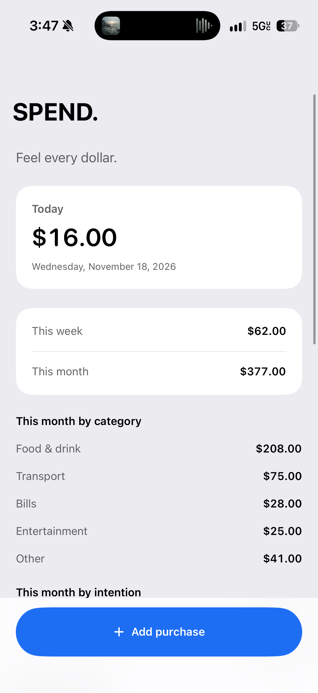
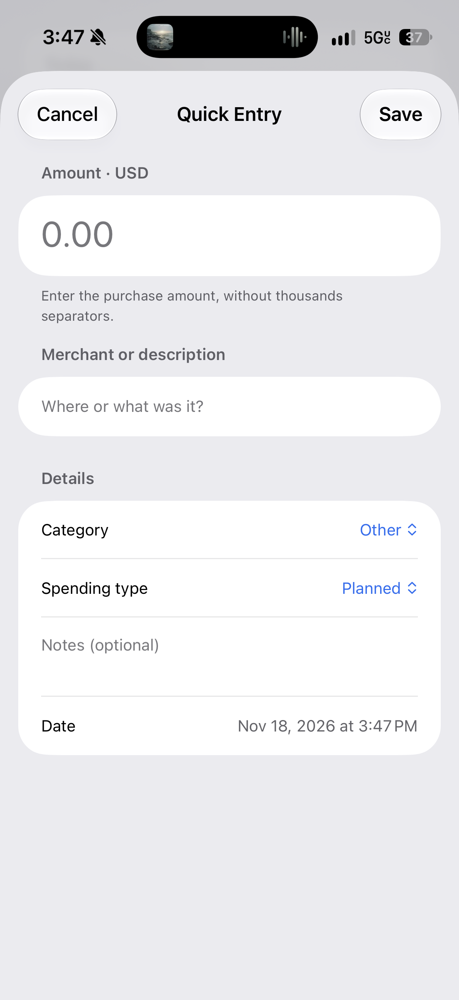
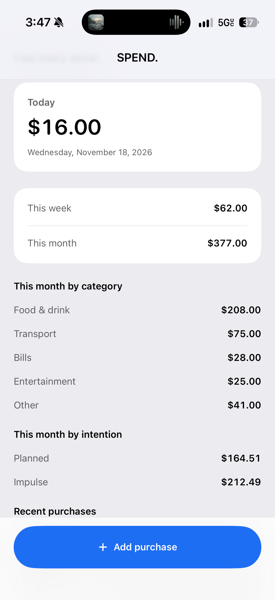
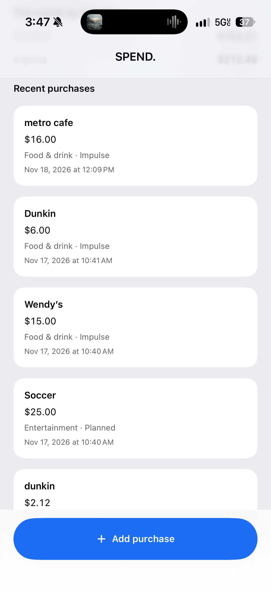

# SPEND.

**Feel every dollar.**

A privacy-first manual spending journal for iPhone. Press the Action Button,
type what you just spent, tap Save. Everything stays on the phone.

<table>
  <tr>
    <td></td>
    <td></td>
    <td></td>
    <td></td>
  </tr>
</table>

Screenshots from an iPhone on 2026-11-18, running what is on `main`: version
0.1.0 plus History.

## What it does

- **Press the Action Button.** SPEND. opens straight into Quick Entry with
  the keypad up and the cursor in the amount field. The same "Log a purchase"
  shortcut appears in the Shortcuts app, Spotlight and Siri.
- **Log the purchase.** Type the amount and where you spent it, pick a
  category and Planned or Impulse, add a note if you want, and tap Save.
  Nothing is saved until you tap Save. Cancel throws the draft away.
- **See where it goes.** The Dashboard shows today, this week and this
  month, your last five purchases, and this month's totals by category and
  by Planned versus Impulse.
- **Look back.** "See all" opens History: every purchase, newest first, one
  section per day with the day's total. Tapping any purchase shows every
  saved field, read-only.
- **Keep it private.** There is no account, no network traffic, no analytics
  and no cloud sync. While the phone is locked, iOS keeps the journal files
  under its strongest file protection.

## Why

Digital payments take away the physical feeling of spending. Individual
purchases blur together and the total is a surprise at the end of the month.
SPEND. asks you to record each purchase by hand, in a few seconds, right
after you make it. That deliberate step is the product, not an inconvenience
to automate away.

The hypothesis is that recording purchases this way improves awareness and
shows impulse patterns. It still needs user validation. Bank connections,
automatic imports, AI coaching and budget forecasting are deliberately out of
scope. See [docs/PRODUCT.md](docs/PRODUCT.md) and
[docs/BRAND.md](docs/BRAND.md).

## How it is built

- **Native and dependency-free.** SwiftUI and SwiftData, iOS 17 and later,
  no third-party packages, no backend. The project is defined in
  `ios/project.yml` for XcodeGen and the generated Xcode project is checked
  in, so it opens and builds without any extra tool.
- **Local-first journal.** A SwiftData store inside the app sandbox with
  CloudKit and autosave off. A failed save keeps the typed draft and offers
  retry. A journal that cannot open shows "Try again" and never deletes or
  replaces data. The journal folder and its store, WAL and SHM files get
  complete file protection.
- **Exact money.** Amounts are stored as integer cents and parsed from
  decimal text without floating point. Zero, negative, over-precise, grouped
  and overflowing input is rejected, and totals check for overflow.
- **Calendar-aware periods.** Today, this week and this month follow the
  user's calendar and time zone, including weeks that cross a year boundary
  and daylight-saving changes. Future-dated purchases are excluded from the
  totals.
- **A shortcut that can only open the app.** "Log a purchase" is an App
  Intent behind an App Shortcut. It opens Quick Entry and nothing else: it
  cannot read, speak or save purchases, and a second run while Quick Entry is
  open keeps the draft.
- **Signing without leaking the team.** The Apple team ID lives in a
  git-ignored `ios/Config/Signing.local.xcconfig`; simulator builds need no
  developer account.

Code lives in `ios/SPEND/`: `App`, `Models`, `Features/Dashboard`,
`Features/History`, `Features/QuickEntry`, `Intents` and `Services`. The
reasoning behind each choice is in
[docs/ARCHITECTURE.md](docs/ARCHITECTURE.md) and
[docs/DECISIONS.md](docs/DECISIONS.md).

## How it was verified

- **Automated tests.** 49 tests (34 unit, 15 UI) pass on iPhone 17 Pro and
  iPhone SE-size simulators on iOS 26.5, none skipped, and the Release
  simulator build succeeds with the DEBUG-only test hooks absent from the
  binary. Tests use synthetic purchases and isolated stores and never touch
  the normal journal.
- **Independent checks.** Every slice is checked by a fresh session with no
  memory of the build. It reruns the test suites and the Release build,
  regenerates the project and compares it byte for byte, reads the evidence
  files, then writes its row in [docs/agents/checks.md](docs/agents/checks.md).
  Each batch includes a security pass: no secrets, packages, networking,
  logging or analytics, and the team ID kept out of git.
- **On a phone.** The Action Button flow, saving, force-quit, lock and
  unlock were observed on an iPhone 18 Pro by the owner, not reproduced by
  the checker. The release notes say which is which:
  [docs/releases/0.1.0.md](docs/releases/0.1.0.md).

## How this was built

I built SPEND. with an AI coding agent, under a process that keeps claims
and evidence apart. Every feature starts as a plan in `docs/plans/` with
the agreed behavior, thin end-to-end slices and an observable acceptance
check for each, and nothing is built until I approve it. Claude Code builds
each slice and records what it did and what it checked in
`docs/agents/build.md`, as a claim. A separate Claude Code session with no
memory of the build then checks the slice against the plan, reruns
everything, and writes `docs/agents/checks.md`. A slice merges only when its
check passes, and a failed check stays in the log. The decisions along the
way, with their reasons and limits, are numbered in `docs/DECISIONS.md`.

## Status and known limits

`main` holds version 0.1.0 (merged and tagged `v0.1.0` on 2026-11-07) plus
History (merged the same day). It has been installed from Xcode on one
iPhone; there is no TestFlight or App Store build. See
[CHANGELOG.md](CHANGELOG.md).

Branch [`look-and-feel`](https://github.com/AymAbdalla/spend-app/tree/look-and-feel)
(built 2026-11-08) adds an app icon, one accent color, Dashboard cards, a
written design system and Apple's accessibility audit in the UI tests. Its
independent check passed one of its three slices and the security pass, and
failed the other two slices on one finding each, so it is not merged.

Known limits on `main`:

- No edit or delete, no category filter or search, no CSV export, no weekly
  reflection. Deleting the app erases its journal, so use fake purchases
  while testing.
- No app icon yet; the Action Button setting and the Shortcuts app show a
  placeholder.
- On the iPhone 18 Pro at default text size, the first recent purchase sits
  behind the Add purchase bar until you scroll.
- USD only, positive amounts only.
- Not tested anywhere: iOS 17 to 25, spoken VoiceOver on a phone, Siri by
  voice and Spotlight.

The roadmap is in [docs/ROADMAP.md](docs/ROADMAP.md).

## Run it

Open `ios/SPEND.xcodeproj`, select the shared `SPEND` scheme and an iPhone
simulator, then Run. You need Xcode with an iOS 17-or-newer SDK; simulator
builds need no developer account.

From the repository root, run the unit and UI tests on an installed
simulator:

```sh
xcodebuild test -project ios/SPEND.xcodeproj -scheme SPEND -destination 'platform=iOS Simulator,name=iPhone 17 Pro,OS=26.5' -parallel-testing-enabled NO CODE_SIGNING_ALLOWED=NO
```

### On an iPhone

1. Find your team ID. It is the `OU=` value printed by this command (or see
   Membership details at developer.apple.com):

   ```sh
   security find-certificate -c "Apple Development" -p | openssl x509 -noout -subject
   ```

2. Create `ios/Config/Signing.local.xcconfig` with one line,
   `DEVELOPMENT_TEAM = <your team ID>`. Git ignores this file. Don't pick the
   team in Xcode's Signing tab, because that writes it into the shared
   project.
3. Unlock the iPhone, connect it by cable and tap Trust. Turn on Developer
   Mode if iOS asks (Settings, Privacy & Security, Developer Mode).
4. Open `ios/SPEND.xcodeproj`, choose the iPhone as the run destination and
   press Run. Approve any prompt to register the app.
5. With SPEND. opened once, go to Settings, Action Button, Shortcut, and
   choose SPEND. "Log a purchase".

With a free Apple account the installed app stops opening after 7 days;
press Run again to reinstall it.

### Regenerate the project

The checked-in project builds directly. After changing `ios/project.yml`,
regenerate it with XcodeGen 2.46.0:

```sh
xcodegen generate --spec ios/project.yml
```

## Documents

- [docs/PRODUCT.md](docs/PRODUCT.md): vision, problem, hypothesis,
  requirements and non-goals.
- [docs/UX.md](docs/UX.md): the screens and the UX principles.
- [docs/BRAND.md](docs/BRAND.md): name, voice and visual direction.
- [docs/ARCHITECTURE.md](docs/ARCHITECTURE.md): stack, data model, storage,
  app structure and test isolation.
- [docs/DECISIONS.md](docs/DECISIONS.md): numbered decisions with their
  reasons and limits.
- [docs/ROADMAP.md](docs/ROADMAP.md): phases and what is done.
- [docs/PLAN.md](docs/PLAN.md) and [docs/plans/](docs/plans/): the approved
  plan for each round of work.
- [docs/releases/](docs/releases/): release notes per version, with what was
  verified and how.
- [docs/agents/](docs/agents/): `build.md` (the builder's claims),
  `checks.md` (the independent checks) and `status.md`.
- [CHANGELOG.md](CHANGELOG.md): what each version contains.

## License

[MIT](LICENSE).
