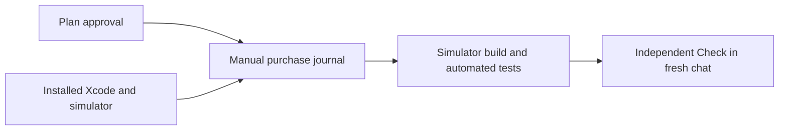

# Quick Entry → SwiftData → Dashboard

Status: approved by the owner with “go” on 2026-11-06; slice built, independently
checked (pass at 5732867, `docs/agents/checks.md`) and merged into `main` on
2026-11-07 as part of version 0.1.0. Build evidence and limits: `docs/agents/build.md`.

## Goal and source

Create the smallest usable native iPhone spending journal: deliberately enter a
purchase, save it locally, and see accurate spending totals and recent purchases.
Source: the current request, `AGENTS.md`, `README.md`, and all six existing documents
in `docs/` (`PRODUCT.md`, `UX.md`, `ARCHITECTURE.md`, `BRAND.md`, `ROADMAP.md`,
`DECISIONS.md`). Manual logging, privacy, simplicity, and nonjudgmental language
remain requirements.

## Repository and tooling inspected

- Clean `main` at `99d4b51`; documentation and placeholder directories only.
- No Xcode project, Swift source, test targets, or existing implementation plan.
- Xcode 27.2, an available iOS 26.5 iPhone 17 Pro simulator, and iOS 27 simulators.
- XcodeGen 2.46.0 is already installed. It can generate the native project from a
  small checked-in definition; the generated project will also be checked in so
  opening, building, and testing it in Xcode does not require XcodeGen.
- `CLAUDE.md` is missing; add its required one-line `@AGENTS.md` during Build.

These are environment checks, not application build or test results.

## Proposed scope and defaults

- One SwiftUI app, one SwiftData model, pure spending calculations, unit tests,
  and a small UI test target. No third-party application dependencies.
- iPhone target with iOS 17 minimum, the first iOS release with SwiftData. Runtime
  verification will use the installed simulator versions; iOS 17 runtime behavior
  cannot be claimed without an iOS 17 runtime.
- Single currency: USD for this first slice. Label the currency explicitly; do not
  interpret the device locale as a currency conversion. Currency settings and
  mixed-currency totals are outside this slice.
- Store positive purchase amounts as integer cents, using decimal parsing and
  checked conversion. Reject zero, negative, malformed, overflowing, and
  over-precision input instead of rounding purchases silently. Never use binary
  floating-point arithmetic for money.
- Require amount and a nonblank merchant or description. Default date/time to
  now, category to Other, and spending type to Planned; both selections remain
  visible and editable. Optional notes.
- Initial categories: Food & drink, Groceries, Transport, Shopping, Bills, Health,
  Entertainment, Other. Persist stable values rather than display labels.
- Dashboard: today, this week, and this month totals; five most recent purchases;
  this month's category totals and Planned / Impulse totals, each labelled with
  its period. Calendar boundaries follow the user's current calendar/time zone.
  Simple summaries satisfy the dashboard scope; reflection and advice stay later.
- Show a useful empty state, save confirmation, validation feedback, and a
  recoverable storage error. Dismiss Quick Entry only after a successful save;
  cancel must save nothing. Never replace a failed disk store with an empty
  in-memory store or delete financial data as recovery.
- Prevent repeated Save taps from saving the same draft twice. Separate,
  intentionally entered identical purchases remain valid.

## UI pattern research

Reviewed these five iOS screens through Mobbin. References inform structure only;
SPEND. will use original copy and composition with system typography, neutral
surfaces, a restrained accent, and native controls.

| Reference | Observed pattern | Use for SPEND. |
| --- | --- | --- |
| [Copilot spending overview](https://mobbin.com/screens/e7591103-070b-45f3-bd00-f73be234e5fc) | Period and total precede a chart and category amounts. | Put labelled totals before the category list; a chart is unnecessary for this slice. |
| [Copilot transaction entry](https://mobbin.com/screens/73ba8b2d-9fd8-439b-b41f-35c62765e697) | Entry sheet emphasizes merchant and amount, with category and a distinct Save button above the keypad. | Amount-first sheet with merchant next and a visible Save action. |
| [Neo Financial spending insights](https://mobbin.com/screens/af3ef809-655b-4d32-b2c3-1ea257d816b3) | A labelled total sits above category rows with amounts aligned at the trailing edge. | Use readable category rows. Banking reference for structure only. |
| [Lloyds spending insights](https://mobbin.com/screens/f06acbc4-ffaa-4b40-8e2c-464e80f3e53c) | An explicit date range gives context to summary amounts. | Label time periods clearly. Banking reference for structure only. |
| [Venmo expense entry](https://mobbin.com/screens/bd3c1e18-a82f-41b0-bcb3-08cca308d31d) | Amount and description lead to a single prominent Add expense button. | Keep one obvious save action. Expense-sharing reference for form structure only. |

Proposed flow: Dashboard → Add purchase → Quick Entry sheet → successful save →
updated Dashboard with confirmation. Use a scrolling layout, Dynamic Type,
VoiceOver labels, light/dark appearance, and controls that do not depend on color.
No custom keypad, onboarding, charts, or animation framework.

## Implementation slice

Keep this as one end-to-end slice rather than separate model and UI milestones.
Create a feature branch named `quick-entry-dashboard` when Build starts.

| Slice | Surfaces | Change | Observable acceptance | Blocked by |
| --- | --- | --- | --- | --- |
| 1: Manual purchase journal | `ios/SPEND.xcodeproj`, project definition, `ios/SPEND/App`, `Models`, `Features/QuickEntry`, `Features/Dashboard`, `Services`, and test targets | Create the project and persistent container; implement validated entry, explicit save, queried dashboard, and isolated calculations; cover the full path with tests. | Enter a USD 12.34 purchase, save once, observe it and matching totals on Dashboard, terminate/relaunch, and observe the same persisted purchase exactly once. | Plan approval; available Xcode and simulator. |

Build in testable increments within the slice: observe failing money/persistence
tests, implement the save path, connect the two screens, then exercise calendar
and failure cases. Keep all test data in isolated test stores. Record Build
claims and pending independent Check in `docs/agents/` using the existing workflow.

## Dependencies

| Dependency | Exists now? | Provider / missing behavior |
| --- | --- | --- |
| Xcode and iOS SDK | Yes | Installed Xcode; stop and report tooling errors if compilation cannot run. |
| iPhone simulator | Yes | Installed iPhone 17 Pro / iOS 26.5; select its explicit identifier for repeatable commands. |
| Project generation helper | Yes | Installed XcodeGen 2.46.0; development helper only, no install needed. |
| Apple developer signing / physical phone | Not needed for simulator checks | Required only for later physical-device acceptance. |
| Backend, credentials, packages | Not needed | SwiftUI, SwiftData, Foundation, and XCTest from Apple. |

## Verification

| Requirement | Check after implementation | Availability |
| --- | --- | --- |
| Native app compiles | `xcodebuild` Debug simulator build with an explicit project, shared scheme, and destination; retain the full log outside the repository. | Tooling available; app not created yet. |
| Precise amounts and valid input | Unit tests for 0.10 + 0.20 = 0.30, supported decimal separators, whitespace, blank merchant, zero/negative amounts, excess decimal places, invalid text, checked range, and total overflow handling. | Tests to be created. |
| Offline disk persistence | Temporary on-disk SwiftData store: save, release/recreate the container at the same URL, fetch and compare every model field. In-memory tests alone do not prove persistence. | Tests to be created. |
| Correct daily/weekly/monthly totals | Fixed-clock tests with explicit calendars/time zones, exact start/end boundaries, week across a year, leap-month boundaries, daylight-saving changes, and exclusion of future purchases. | Tests to be created. |
| Category and spending type summaries | Unit fixtures with known category and Planned / Impulse amounts; summary totals reconcile to the same monthly total. | Tests to be created. |
| Save once; cancel saves nothing | UI tests for repeated Save taps and cancellation; test that intentionally separate identical purchases can both be saved. | Tests to be created. |
| Entry → Dashboard → relaunch | UI test enters a purchase, verifies totals/recent row, terminates and relaunches without resetting its isolated store, and verifies persistence. | Tests to be created. |
| Storage failure handling | Inject a failing save at a narrow test seam; verify entry is preserved, no success is reported, and retry creates one purchase. Verify container failure offers retry without data deletion. | Tests to be created. |
| Accessible, calm interface | Inspect simulator screenshots in light/dark and large Dynamic Type; check labels, scrolling, keyboard access to Save, readable amounts, empty/error states, and a small iPhone simulator. | Simulator available; physical VoiceOver acceptance remains separate. |
| Privacy | Inspect entitlements, dependencies, configuration, and logging: local store, no CloudKit sync, no analytics, no financial content in logs. | Source review after Build. |

Run the shared scheme's unit and UI tests with `xcodebuild test`, retaining the
result bundle and full output outside the repository. Report pass, fail, error,
and unavailable checks separately. Build verification is self-checking; a fresh
chat performs the independent Check required by the project workflow.

## Security

Purchase amounts, merchant names, dates, and notes are private financial data.
The app user enters them through local fields; only the app's private local store
needs access. Validate text and money input, explicitly disable CloudKit use,
avoid network services and analytics, and do not log purchase content. Keep test
fixtures synthetic and isolated from the user's store. A startup or save error
must never trigger silent data loss. This slice adds no credentials, external
accounts, payments, or background automation.

## Risks and limits

- USD-only, positive purchases, default category, and default Planned are
  proposals for approval here, not previously confirmed product decisions.
- SwiftData reopening and error handling are early verification priorities;
  successful in-memory tests cannot close these risks.
- Current simulator tests cannot establish physical iPhone behavior, physical
  VoiceOver acceptance, or runtime support on unavailable older iOS versions.
- Full history, editing/deleting, CSV export, weekly reflection, and Action Button
  / App Intent integration remain on the documented roadmap. Action Button is
  the next integration after this core slice; it is not part of this Build.
- Update architecture, decision log, README, and only proven roadmap items after
  implementation; retain planned versus built versus independently checked state.

## Flow

## Approval

Approve this proposed scope and defaults to begin Build. Approval covers the
native project, the single vertical slice, its tests, and documentation updates.
Build stops with inspectable evidence and a fresh-chat Check handoff. Shipping,
merging, installing on a physical phone, and later roadmap features need their
own authorization. No application code, project configuration, or tests have
been created during this Plan phase.
