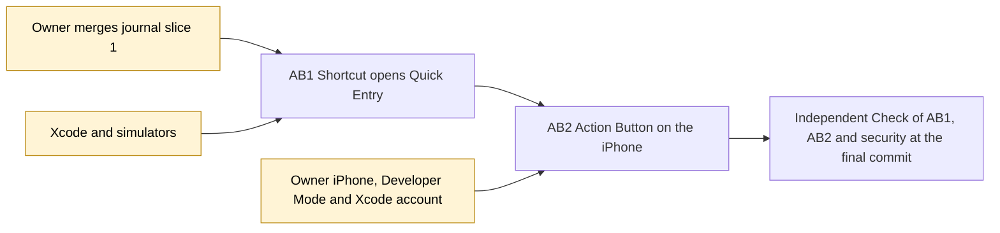

# Action Button → Quick Entry plan

Status: approved by the owner on 2026-11-07. The owner chose to stack
`action-button-shortcut` on `quick-entry-dashboard` rather than merge it into
`main` first, so the final Check records fresh rows for `1`, `AB1`, `AB2` and
security. Source of agreement: Clarify on 2026-11-07
(owner said "go" to the recommended option: include physical-iPhone acceptance),
`docs/UX.md` (Action Button section), `docs/PRODUCT.md` (core journey step 2),
`AGENTS.md` (First Task: Action Button follows the first slice), and
`docs/DECISIONS.md` 009 and 011. The first-slice plan stays in `docs/PLAN.md`.

## Goal

When the owner presses the iPhone Action Button, SPEND. opens straight into
the existing Quick Entry sheet with the amount field ready. The owner types the
amount and merchant, taps Save, and lands on the Dashboard with updated totals.
The button only opens the app: the shortcut never saves, reads or summarizes
purchases by itself, so manual entry stays deliberate and the journal keeps
its single foreground writer.

How it works, in plain terms: the app tells iOS about one action, "Log a
purchase" (an *App Intent*), and offers it as a ready-made *App Shortcut*.
iOS lists App Shortcuts in Shortcuts, Spotlight, Siri and the Action Button
setting without the owner building anything. When the action runs, iOS opens
SPEND. and the action leaves a note, "open Quick Entry", that the Dashboard
picks up.

## Agreed behavior

| Situation | Result |
| --- | --- |
| Shortcut runs, app closed or in the background | App opens on Dashboard with Quick Entry presented and the amount field focused. |
| Save | Same as today: one purchase saved, sheet closes, "Purchase saved." confirmation and announcement, totals update. |
| Cancel | Same as today: nothing saved, no success announcement. |
| Quick Entry already open with typed text | Shortcut runs again: the sheet stays and the typed text is kept. |
| A purchase was just saved ("Purchase saved." showing) | Shortcut clears the old confirmation, then opens Quick Entry, exactly like Add purchase. |
| Journal still opening, or failed to open | The loading or "Try again" screen shows first. Quick Entry opens once the journal is open. Nothing is deleted. |
| Phone locked | iOS is expected to ask for Face ID or passcode before opening the app. Recorded as an observation on the phone, not promised. |

Defaults (proposed, cheap to change): shortcut title "Log a purchase"; Siri
and Spotlight phrase "Log a purchase in SPEND."; icon `plus.circle`. Out of
scope: amounts spoken to Siri, a Control Center control, Home Screen widgets,
saving without opening the app, and any shortcut that reads totals aloud.

No new screen is designed. Quick Entry and Dashboard are reused unchanged
visually, so no Mobbin pattern search is needed for this plan.

## Slices

Slice IDs are `AB1` and `AB2` in `docs/agents/build.md` and `checks.md`, so
they never mix with the journal's finished slice `1`.

| # | Slice | Surfaces | Change | Acceptance check | Blocked by |
| --- | --- | --- | --- | --- | --- |
| AB1 | Shortcut opens Quick Entry | New `ios/SPEND/Intents/` (intent and shortcut provider), new app-level request holder in `ios/SPEND/App/`, `SpendApp.swift`, `DashboardView.swift`, `AppConfiguration.swift` (DEBUG-only hook), unit and UI tests, regenerated `SPEND.xcodeproj`, `DECISIONS.md` 013, `ARCHITECTURE.md`, `ROADMAP.md` (tick "App Intent / App Shortcut" only), `README.md` | Add the "Log a purchase" intent (opens the app; its only job is to record "open Quick Entry"), the App Shortcut, a request holder that outlives the Dashboard, and Dashboard code that honors a request the same way Add purchase does. | A UI test runs the real intent at launch (simulated trigger): Quick Entry appears with the amount field focused; typing 12.34 and Test cafe and tapping Save shows $12.34 today and one Test cafe row. Edge cases in the Verification table pass. The built app's App Intents metadata lists "Log a purchase" as an app-opening shortcut. All 30 existing tests still pass on iPhone 17 Pro and iPhone SE. | Slice 1 of the journal merged to `main` (or owner chooses to stack the branch); installed Xcode and simulators. |
| AB2 | Action Button on the owner's iPhone | `ios/Config/` (committed shared settings file plus a git-ignored local file for the signing team), `ios/project.yml`, `.gitignore`, regenerated project, `README.md` run-on-iPhone steps, `ROADMAP.md` ("Action Button setup" and "Test on physical iPhone" ticked only if their checklist steps pass), `DECISIONS.md` 011 (what the phone showed about locked-file protection), `docs/agents/build.md` evidence index | Let the owner sign and install from Xcode without the team ID entering git, then run the phone checklist below with the owner. | On the owner's iPhone 18 Pro: Settings → Action Button → Shortcut lists "Log a purchase"; tapping it in the Shortcuts app opens Quick Entry; pressing the button from the Home Screen opens Quick Entry; saving a clearly fake purchase (TEST, 1.00) shows it on the Dashboard; it is still there after force-quit, lock and unlock. `git grep` finds no team ID. Simulator suites still pass. | AB1; owner's iPhone, cable, Developer Mode and signed-in Xcode account; owner's yes to install. |

AB1 is one end-to-end path: a request holder or intent with nothing calling it
would be a layer, not a slice. AB2 can't run without AB1's shortcut.

**Order of work and checks.** Build AB1, self-check, commit; build AB2, run
the phone checklist, self-check, commit. Every documentation change (README,
ROADMAP, DECISIONS, ARCHITECTURE and this plan file) is committed before the
independent Check starts, because the merge gate treats any commit outside
`docs/agents/` as new code and would make an earlier pass stale. One fresh
chat then checks AB1, AB2 and security together at the final commit, as the
house rules' 2–3-slice batch. This plan file is committed on the new branch
only, never on `quick-entry-dashboard`, where it would make the journal's
recorded pass stale.

### AB1 build notes

- **Intent.** `static let openAppWhenRun = true` for iOS 17–25, plus
  `@available(iOS 26.0, *) static var supportedModes: IntentModes { .foreground(.immediate) }`
  for iOS 26 and later. The iOS 27.2 SDK marks `openAppWhenRun` as deprecated
  from iOS 26 ("Please provide 'supportedModes' instead", AppIntents
  interface line 7218). The system-trigger spike declared both; it built with
  no warnings for the app target and wrote both into the app's metadata.
  `perform()` runs on the main actor, sets the request, and returns `.result()`
  with no dialog or value. It must not receive or touch `StoreState`, `ModelContainer`,
  `ModelContext`, the commit closure or `JournalStore`.
- **Shortcut provider.** One `AppShortcut` using the iOS 17 four-argument form
  (intent, phrases, short title, system image). Every phrase includes the app
  name token, as Apple's App Shortcut phrases expect.
- **Request holder.** A small `@MainActor @Observable` type with a shared
  instance (the intent can run before the SwiftUI app body exists) and a plain
  initializer for unit tests. It holds one pending flag. It must not depend on
  `StoreState`, so hosted unit tests keep a nil app journal
  (`RecoveryTests.testHostedUnitTestsHaveNoAppJournalStoreState`).
- **Dashboard.** Observe the pending flag with `initial: true`, so a request
  made before the Dashboard existed (cold launch, loading, retry screen) is
  honored when it first appears. If the sheet is closed: `saved = false`, then
  `showingEntry = true`, mirroring Add purchase (otherwise a later Cancel would
  announce "Purchase saved", against DECISIONS 012). If the sheet is open: do
  nothing, which keeps the draft. Clear the flag in both cases.
- **Quick Entry.** Already focuses the amount field on appear
  (`QuickEntryView.swift`, `.onAppear { focusedField = .amount }`); expected to
  need no change. A UI test now asserts it.
- **DEBUG hooks.** Follow the existing gate in `AppConfiguration.swift`
  (`#if DEBUG` plus a valid `-journal-test-store` UUID). One argument runs the
  real intent's `perform()` during app start-up, before the journal opens, so
  the same test covers "still opening"; a second runs it each time the app
  becomes active, so a test can background the app, return, and fire a second
  request. Release builds must not contain either string. The phone run uses
  no launch arguments, so the hooks stay inactive there.
- **Project.** Add files under `ios/SPEND/`, regenerate with XcodeGen 2.46.0,
  and confirm regeneration is byte-stable. The old build notice "Metadata
  extraction skipped, no AppIntents.framework dependency found" should
  disappear for the app target once it imports App Intents.

### What the planning spikes showed

Throwaway spike apps under
`~/aym/agents/work/spend-temp/2026-11-07-action-button-plan/` (not in this
repo) tested the risky parts on the iPhone 17 Pro iOS 26.5 simulator:

| Question | Result | Evidence |
| --- | --- | --- |
| Can a unit test run the intent and see the request? | pass | `testing/run1.log`: 2 tests, 0 failures |
| Does the build publish the shortcut? | pass | `system-trigger/dd/.../Spike.app/Metadata.appintents/extract.actionsdata` (intent declaring both settings) holds "Log a purchase", the app-name phrase, `openAppWhenRun: true` and `supportedModes: 2`; `system-trigger/build.log` has no warnings for the app target (the test targets still show the "skipped" notice) |
| Can a UI test press the Action Button? | pass, but not useful | `XCUIDevice.shared.press(.action)` works, yet the Simulator's Settings has no Action Button page, so the press only toggles Silent Mode |
| Can typing to Siri run the shortcut? | fail | `testing/run2.log`: the intent never ran |
| Can a UI test tap the shortcut in the Shortcuts app? | fail | Warm: `system-trigger/run-ShortcutsWarm.log` prints "Unable to run App Shortcut". Cold: the same alert is in `system-trigger/shots/sc-cold-3-tapped.png`, after which the test lost its accessibility connection. Cause not isolated (possibly the unsigned test build) |
| Can a UI test search Spotlight for it? | fail | `system-trigger/run-SpotlightCold.log`: the search field never took typed text |
| Does the intent run before or after the app's views exist on a cold launch? | unavailable | No system-triggered launch happened, so the design must work in both orders |

So automated tests prove "once the intent runs, the app lands in Quick Entry
and saving works". Only the phone proves "iOS runs the intent when the
button is pressed".

AB1 also makes one bounded attempt at the Shortcuts-app tap with a
normally signed simulator build. It is not an acceptance gate: if iOS still
refuses, the builder records it as unavailable and moves on.

### AB2 signing notes

A committed `ios/Config/` settings file optionally includes a git-ignored local
file that holds `DEVELOPMENT_TEAM`; `project.yml` attaches it through XcodeGen
`configFiles`. The empty `DEVELOPMENT_TEAM` in `project.yml` base settings
must be removed, or it overrides the local file. Regeneration stays
byte-stable, and a fresh clone without the local file still builds for the
simulator.

### AB2 phone checklist (owner and builder together)

Use only fake purchases: edit and delete don't exist yet, so anything saved on
the phone stays until the app is deleted from the phone, and deleting the app
erases its whole journal.

0. Before installing: the owner confirms whether SPEND. is already on this
   phone with real purchases. If it is, stop and decide together before
   step 2, because test rows would mix with real ones and can't be removed.
1. Unlock the iPhone 18 Pro, connect it by cable, tap Trust, and turn on
   Developer Mode if iOS asks (Settings → Privacy & Security).
2. Put your team in the git-ignored local settings file (not in Xcode's
   Signing tab, which would write it into the shared project), choose the
   iPhone in Xcode and press Run. Approve any prompts to register the app.
3. Screenshot the Dashboard (0 purchases).
4. Settings → Action Button → Shortcut → choose SPEND. "Log a purchase".
   Screenshot the setting.
5. Close SPEND. Open the Shortcuts app, find SPEND. "Log a purchase" and tap
   it. Expected: Quick Entry opens. Cancel. (This separates "the shortcut
   works" from "the button is set up", in case step 6 fails.)
6. Phone unlocked, SPEND. closed: press the button. Expected: Quick Entry
   with the amount field ready. Screen-record steps 6–7.
7. Enter 1.00 and TEST, Save. Expected: Dashboard shows $1.00 and one TEST row.
8. Open Quick Entry, type 2, press the button again. Expected: the 2 is kept.
   Cancel.
9. Lock the phone, press the button, and write down exactly what happens.
   Likely outcomes: an unlock prompt, then Quick Entry; or the "Your journal
   couldn't open" screen. The second would be a follow-up finding, not fixed
   in this plan.
10. Force-quit SPEND., lock and unlock, reopen. Expected: the TEST purchase is
    still there (first real check of the locked-file protection from
    DECISIONS 011).

Screenshots and recordings go to `~/aym/agents/outputs/spend/action-button/`
(outside the repo). The builder's `build.md` row lists each step as pass,
fail or unavailable with its file name, plus only "iPhone 18 Pro, iOS 27.2"
(no device identifiers). The independent checker reruns the simulator suites,
the team-ID search and the fresh-clone build, inspects the evidence files,
and labels the phone steps "owner-observed, not reproduced".

## Dependencies

| Dependency | Needed by | Exists now? | Provider | If missing |
| --- | --- | --- | --- | --- |
| Journal slice 1 on `main` | AB1 branch base | No: checked and gate passes on `quick-entry-dashboard`, not merged | Owner says "merge" | Stack the new branch on `quick-entry-dashboard` (owner's choice) |
| Xcode 27.2, iOS 26.5 iPhone 17 Pro and iPhone SE simulators, XcodeGen 2.46.0 | AB1 | Yes | Installed | Stop and report the tool error |
| App Intents framework | AB1 | Yes, in the iOS 27.2 SDK | Apple | n/a |
| iOS 17–25 runtime | Older-iOS behavior | No (only iOS 26.5 and 27 runtimes; phone is 27.2) | Apple simulator download, owner's yes | Marked unavailable, as in the journal slice |
| Owner's iPhone with an Action Button | AB2 | Paired before ("iPhone18 Pro", iPhone 18 Pro, iOS 27.2); currently offline | Owner | AB2 waits; button press stays unverified |
| Apple Developer signing | AB2 | An Apple Development certificate is on this Mac; local profiles last about a year, suggesting a paid membership (not confirmed) | Owner's Xcode account | Free account: reinstall every 7 days |
| Developer Mode on the iPhone | AB2 | Unknown | Owner, on the phone | AB2 waits |

## Verification

| Requirement | Check | Runs now? |
| --- | --- | --- |
| Intent opens the app and only records a request | Unit test: run `perform()` on the main actor; the request flag is set; the intent declares app-opening (`openAppWhenRun`, and `supportedModes` on iOS 26+). Source review: the intent file references no journal, store, context or save. | After AB1 code exists |
| Shortcut is published to iOS | Inspect the built app's `Metadata.appintents` for "Log a purchase", the app-name phrase and app-opening mode; quote it. Build log no longer shows the "skipped" notice for the app target. | After AB1 |
| Cold launch → Quick Entry → save → Dashboard | UI test with the simulated trigger: sheet appears, amount field focused (Done control present without tapping), 12.34 + Test cafe saves once, today $12.34 and one row. | After AB1 |
| Journal still opening | Covered by the cold-launch test: the hook runs `perform()` during start-up, before the journal opens; Quick Entry opens once the Dashboard appears. | After AB1 |
| Journal failed to open | UI test with `-fail-initial-load` plus the trigger: retry screen first and no sheet; after Try again, Quick Entry opens. | After AB1 |
| Cancel after a triggered open | UI test: trigger, type an amount, Cancel; no purchase rows, today $0.00, no "Purchase saved." label. | After AB1 |
| Typed draft kept | UI test: trigger, type an amount, send the app to the background, return so the trigger fires again; the amount is still in the field and one sheet is shown. | After AB1 |
| No false "Purchase saved" | UI test: save, then trigger; the old "Purchase saved." label is gone while the sheet is open; Cancel leaves it gone. Spoken output stays a phone check. | After AB1 |
| Existing behavior unchanged | Full suites on iPhone 17 Pro and iPhone SE (iOS 26.5): all existing 30 tests plus the new ones pass; Release simulator build passes. | After AB1 |
| DEBUG hooks absent from Release | Search the Release binary for the new hook strings: none found. | After AB1 |
| iOS itself runs the shortcut | Optional in AB1: UI test taps "Log a purchase" in the Simulator's Shortcuts app with a signed build (failed in the unsigned spike; not a gate). Required in AB2: phone checklist step 5. | Optional attempt in AB1; phone in AB2 |
| Action Button runs the shortcut | Phone checklist steps 4 and 6–8 | AB2 only (owner's phone) |
| Locked phone | Phone checklist step 9, recorded as an observation | AB2 only |
| Team ID stays out of git | `git grep` for the team ID and `git status` before each commit: nothing. Fresh clone builds for the simulator without the local file. | AB2 |
| Older iOS (17–25) | Not checkable here | Unavailable |

## Security

- **Worth protecting:** the purchase journal (amounts, merchants, notes) and
  the guarantee that nothing is saved without a deliberate tap on Save.
- **Who can reach it:** anyone holding the phone can press the Action Button or
  ask Siri to "Log a purchase in SPEND."; App Shortcuts are visible in
  Spotlight and Shortcuts, and a Shortcuts automation could run it. Repeated
  runs collapse into one pending request. The intent takes no input, so there is nothing
  external to validate.
- **What stops misuse:** the intent only opens the app; it cannot read, return,
  speak or save purchases, so the lock screen and Siri never expose journal
  content. Opening the app is expected to require unlocking, which also keeps
  the locked-file protection (DECISIONS 011) in force; AB2 records what
  actually happens. Test hooks stay behind `#if DEBUG` and the test-store UUID,
  and AB1 checks they are absent from Release. No network, analytics,
  packages, entitlements or logging are added. The signing team ID is not a
  secret, but it stays in a git-ignored local file by default.

## Risks, open decisions and fog

- Open decision: merge `quick-entry-dashboard` into `main` first (recommended),
  or stack this work on it (needs the owner). Stacking means the merge gate
  also counts the journal's slice `1` on this branch, so the final Check must
  record fresh rows for `1`, `AB1`, `AB2` and security.
- Open decision: phone acceptance is included as AB2 because "go" accepted
  the recommendation; dropping it leaves the button press unverified (owner).
- Risk: automated tests can't make iOS run the shortcut. The Simulator has no
  Action Button settings page, and in the spikes Siri, the Shortcuts app and
  Spotlight all failed to run it. → AB2 proves it on the real phone; build
  records label simulator results as "simulated trigger".
- Risk: "Unable to run App Shortcut" in the spike could also happen on the
  phone if the cause is in the intent rather than the unsigned test build. →
  Phone step 5 isolates it; if it fails there, Build stops and moves to Debug
  rather than guessing.
- Risk: on iOS 26 and later, the precedence between `openAppWhenRun` and
  `supportedModes` is undocumented. → Declare both with the same meaning; the
  phone (iOS 27.2) is the runtime check.
- Risk: the shortcut may appear in the Action Button list only after the app
  has been opened once. → Checklist opens the app at install (step 2) before
  step 4.
- Risk: a request that arrives while the sheet is closing could be dropped or
  open a blank sheet. → Test it in AB1; if flaky, honor the request after
  the dismissal finishes.
- Risk: removing the empty `DEVELOPMENT_TEAM` from `project.yml` and adding the
  settings files could change simulator builds. → AB2 reruns both suites
  and a fresh-clone simulator build.
- Risk: a launch from the locked phone could reach the journal before its
  protected files are readable and show "Your journal couldn't open". → Step 9
  records it; Try again keeps data safe. An automatic retry would be a new,
  separately documented change.
- Risk: the phone may already hold real purchases, and test rows can't be
  removed without deleting the app and its journal. → Checklist step 0.
- Fog: iOS 17–25 behavior can't be run here; revisit if an older runtime or
  device becomes available.
- Fog: spoken VoiceOver output for the shortcut path; revisit at the roadmap's
  accessibility review.
- Fog: Siri-by-voice on the phone works through the same intent but isn't part
  of acceptance; note it if tried.

## Flow

## Approval

Approving this plan authorizes Build of AB1 and AB2 on a new feature branch
`action-button-shortcut` (from `main` once merged, or from
`quick-entry-dashboard` if the owner chooses to stack), XcodeGen regeneration,
simulator builds and tests, documentation updates, and commits of finished
slices and their agent records on that branch. Installing on the iPhone needs
the owner's yes at that step, and the owner performs the phone steps.
Merging, pushing, creating a GitHub repository, TestFlight or App Store
distribution, downloading simulator runtimes, and any feature listed as out of
scope need separate authorization.
