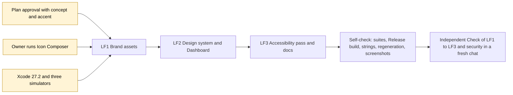

# Look-and-feel plan

Status: built (LF1 to LF3, 2026-11-08), awaiting the independent Check. Approved
for Build on 2026-11-08, when the owner asked to build LF1 to LF3 with stops
after each slice; Build used the recommended concept B and accent A, which the
owner confirmed with the LF1 go. At the LF2 stop the owner accepted one swipe on
the small phone (option 1 below). Source of agreement: Clarify on
2026-11-07, where the owner chose option 1 to each of four questions (scope,
icon format, accent, Dashboard order); `docs/BRAND.md` Visual Direction;
`docs/UX.md` principles; `docs/DECISIONS.md` 002, 009, 012, 013 and 014;
`docs/agents/checks.md` H1 row (two "consider" notes); `docs/releases/0.1.0.md`
known limits (no icon, Dashboard overlap); `docs/ARCHITECTURE.md` design-system
paragraph. Work happens on branch `look-and-feel` in the worktree
`.claude/worktrees/look-and-feel`, cut from `main` at 4fef33f.

Two visual picks are part of approving this plan: the icon concept (A, B or C)
and the accent candidate (A, B or C). Sketches and contrast numbers live
outside the repository in `/Users/aympulse/aym/agents/outputs/spend/look-and-feel/`
(`icon-concepts-sheet.png`, one 1024-pixel render per concept and accent,
`accent-contrast.md`). Recommendation: concept B with accent A.

## Goal

SPEND. gets its own face without changing what it does. The home screen,
Settings → Action Button and the Shortcuts app show a SPEND. icon instead of a
blank placeholder. One brand accent replaces the default blue on every button
and link. The Dashboard shows the purchase you just saved without scrolling,
and every section sits on the same card surface. The rules behind these
choices are written down in `docs/DESIGN.md` so later screens match. Nothing
about saving, cancelling, retrying, the shortcut, History or the detail
changes, and no animation or haptic is added.

How it works, in plain terms: an iOS app's colors and icon live in an asset
catalog, a folder Xcode compiles into the app. Today SPEND. has none, so iOS
falls back to its default blue and a placeholder icon. This round adds that
catalog with one named color, `AccentColor`, which SwiftUI applies to every
tinted control automatically, plus an Icon Composer file, Apple's layered
icon format that iOS 26 renders as glass and that Xcode flattens for older
versions. The Dashboard change is a reorder of existing sections plus one
shared card style, so the same data appears in a different order.

## Agreed behavior

| Situation | Result |
| --- | --- |
| Home screen, Spotlight, Shortcuts app, Settings → Action Button → Shortcut | Show the SPEND. icon. On iOS 26 and later it is the layered glass icon; on iOS 17 to 25 it is the flattened version Xcode generates from the same file. |
| Tinted controls in light mode | Add purchase, See all, Done, picker values, Try again and the Cancel and Save buttons use the accent's light variant. |
| Tinted controls in dark mode | The same controls use the accent's dark variant. |
| Planned and Impulse | Stay text only. No color carries meaning anywhere in the app. |
| Dashboard order | Tagline; "Purchase saved." when shown; Today card; This week and This month card; Recent purchases with See all and up to five rows; This month by category card; This month by intention card; the USD footnote. |
| Dashboard surfaces | Every section is a card with the same surface color, corner radius and padding. Purchase rows show a trailing chevron because they open the detail. |
| Right after saving, default text size | On iPhone 18 Pro and iPhone 17 Pro, the first recent purchase is fully visible above the Add purchase bar without scrolling. On the small phone (iPhone SE size) it is fully visible after one swipe: Build measured 70 points too little room under the unchanged Today and period cards, and the owner chose this over changing the order or the cards on 2026-11-08. |
| Accessibility text sizes | Everything remains reachable by scrolling, as today. Rows stack their amount under the merchant, as today. |
| History day headers | The day total renders in primary text color; the date stays secondary. |
| Quick Entry, History, Detail | Use the same surfaces and type roles as the design system. Copy and flow are unchanged, except an accessibility label the audit requires. |
| "Log a purchase" tile in the Shortcuts app | Uses the system tile color nearest the accent. The tile's `plus.circle` symbol stays (DECISIONS 013). |
| Accessibility audit | Each screen passes the XCUITest accessibility audit at default text size on both iOS 26.5 simulators. Any exception is listed in the test with its reason. |
| Motion | No animation or haptic is added. Nothing needs the Reduce Motion check because nothing moves. |
| Everything else | Saving, cancel, retry, the shortcut, History, the detail and the journal are unchanged. All 49 existing tests still pass. |

Proposed, not agreed (cheap to change): the five recent purchases sit in one
card separated by dividers, like History's rows, instead of five separate
cards. Reason: one surface per section is calmer and matches History. Say so
to keep one card per purchase.

### Scope

In scope: the asset catalog with `AccentColor`; the `AppIcon.icon` package and
its source layer files; the shortcut tile color; `docs/DESIGN.md`; a shared
card style and the Dashboard reorder; chevrons on Dashboard rows; the History
header total color; small surface and type alignments on Quick Entry, History
and the detail; the accessibility audit tests and the fixes they require; a
new UI test for the Dashboard order; documentation updates.

Out of scope: haptics, animations, transitions; Quick Entry flow changes;
launch screen styling; alternate icons; widgets; custom typefaces; color
meaning for Planned and Impulse; edit, delete, filter, search, CSV export,
reflection; verifying iOS 17 to 25 rendering (no runtime installed); spoken
VoiceOver on the phone (owner-observed, separate); App Store assets.

### Terms

- **Accent:** the one color iOS uses for tinted controls. Set once as
  `AccentColor` in the asset catalog; SwiftUI applies it everywhere.
- **Surface / card:** a rounded block on `secondarySystemGroupedBackground`
  over the page's `systemGroupedBackground`, the two system colors that stay
  distinct in light and dark mode.
- **Layered icon:** an Icon Composer `.icon` package (a folder of layer images
  and a JSON file). iOS 26 renders its layers as glass with depth.
- **Fallback icon:** the flattened image Xcode produces from the layered icon
  for iOS versions before 26.
- **Audit:** `XCUIApplication.performAccessibilityAudit`, Apple's automated
  check for contrast, hit region, element descriptions, Dynamic Type, clipped
  text, traits and parent-child structure, run from a UI test.
- **Design system:** `docs/DESIGN.md` plus the asset catalog plus two or three
  small shared SwiftUI pieces. Not a framework or a package.

### Decisions and sources

- Full round, no new behaviors: owner's reply "1" to Clarify question 1.
- Layered Icon Composer file with Xcode's fallback, concept chosen from
  sketches: reply "1" to question 2.
- One brand accent, light and dark variants, no color meaning: reply "1" to
  question 3; `docs/UX.md` "Accessible controls"; `docs/BRAND.md` "Subtle
  accent colors".
- Dashboard order with Recent purchases third and breakdowns as cards: reply
  "1" to question 4; the overlap recorded in `docs/releases/0.1.0.md`.
- History header total primary and Dashboard row chevrons: `checks.md` H1
  "consider" notes, 2026-11-07.
- Shortcut symbol stays `plus.circle`: DECISIONS 013.
- No motion, Reduce Motion respected: `docs/UX.md` UX Principles.
- Concept B and accent A: the plan's recommendation, confirmed by the owner's
  go after LF1 on 2026-11-08.
- One swipe on the small phone: the owner's "go 1" at the LF2 stop on
  2026-11-08, choosing it over moving Recent purchases above the period card
  (option 2) or trimming the tagline and the Today date line (option 3).

### Open items

- Icon concept A, B or C. Blocks LF1. Owner decides with approval.
  Recommended: B.
- Accent candidate A, B or C. Blocks LF1 and the color roles in LF2. Owner
  decides with approval. Recommended: A.
- Older-iOS fallback. New evidence after Clarify: Apple lists a known issue,
  "Icon Composer icons back deploy to older versions of iOS, macOS, and
  watchOS with inconsistent rendering (152258860). Workaround: keep the
  previous Asset Catalog app icon" (quoted by
  [useyourloaf.com](https://useyourloaf.com/blog/adding-icon-composer-icons-to-xcode/),
  updated 2026-07-30). Options: keep the agreed layered-file-only approach
  (recommended: no device here runs iOS 17 to 25, nothing can verify a
  fallback either way, and the catalog-plus-layered combination has its own
  reported conflicts), or add a flat PNG icon set now and turn off Xcode's
  generated fallback. Owner decides; the default is the agreed option.

## UI pattern research (Mobbin)

Reviewed on 2026-11-07 through Mobbin. Patterns inform structure only; SPEND.
keeps its own copy and composition with system typography and native controls,
and copies no product's design or branding.

| Reference | Observed pattern | Use for SPEND. |
| --- | --- | --- |
| [Quicken dashboard](https://mobbin.com/screens/48ef3fe1-d56a-4b3b-ac48-34375808e966) | A totals hero card, then a "Recent Spending" card with its period label and transaction rows directly beneath; one card per section. | Recent purchases come right after the totals; every section is a card. |
| [Brex home](https://mobbin.com/screens/0c4d8d23-8708-4ac3-bca1-66dba66ca90e) | "Recent expenses" sits directly under the available-today total, with an "All expenses" link after the rows. | Recent purchases before any breakdown; See all stays. |
| [Commons home](https://mobbin.com/screens/cf577a21-2a0c-45fa-b0cf-465eb51e5922) | "Recent transactions" header with "See all" at its trailing edge; rows carry the amount at the trailing edge. | Keep See all in the section header, amount trailing. |
| [Origin spending](https://mobbin.com/screens/e8629299-e211-48dd-ad15-3b2d3cfc9b60) | Breakdown and recurring sections are cards with the same surface, each with category rows and amounts. | Category and intention breakdowns become cards with the same style as the totals. |
| [Monarch dashboard](https://mobbin.com/screens/eff6b2af-549f-4f68-88f0-1a50b8237bbe) | Uniform cards with a title and a subtitle link; one surface style across the screen. | One card style, one header style, across the Dashboard. |

## Design

### App icon

- Three concepts are sketched at
  `/Users/aympulse/aym/agents/outputs/spend/look-and-feel/icon-concepts-sheet.png`,
  each at 256 pixels and at the 60-pixel home-screen size on light and dark:
  **A Full stop** (the period of "SPEND." as a large dot, lower right),
  **B S. monogram** (a rounded S with its dot), **C Ring and dot** (a thin
  ring around a dot). Recommended B: it is the most legible at 60 pixels, it
  names the app, and the dot can be its own glass layer. A is the boldest
  minimal option; C reads like a record or camera symbol.
- Files: layer sources as SVG in `design/assets/icon/` (background is Icon
  Composer's own fill; glyph layers white: the S path and the dot as separate
  layers for B). The S is drawn as an original path from arcs, not a font
  glyph: the sketch used SF Rounded for speed, but Apple's font license does
  not cover shipping its glyphs as artwork, and no font-outline tool is
  installed. The package is saved as `ios/SPEND/AppIcon.icon` so the existing
  `ASSETCATALOG_COMPILER_APPICON_NAME = AppIcon` setting matches its name.
- Icon Composer is a graphical tool, so the owner performs the import, with
  written steps from the builder: new icon, import the layer SVGs, set the
  background fill to the accent, check the default, dark, clear and tinted
  previews, save as `AppIcon.icon`. Fallback if that cannot happen: the
  builder writes the package by hand (`icon.json` plus the layer files) and
  the owner only opens it in Icon Composer to confirm it loads.
- Project definition: `ios/project.yml` lists `SPEND/AppIcon.icon` as a single
  file resource (`type: file`, `buildPhase: resources`) and excludes it from
  the folder scan, so XcodeGen treats the package as one resource instead of
  loose JSON and SVG files. This follows a reported XcodeGen fix
  ([Classmethod](https://dev.classmethod.jp/articles/icon-composer-not-applied/)).
  The asset catalog holds no `AppIcon` set, because a catalog icon beside a
  layered icon has reported conflicts
  ([Apple forums](https://developer.apple.com/forums/thread/787447)).

### Accent

Candidates with WCAG contrast computed on 2026-11-07 (`accent-contrast.md`
has every pair). Recommended A.

| Candidate | Light variant | Dark variant | Shortcuts tile | Why |
| --- | --- | --- | --- | --- |
| A Deep teal | #0B7A75 | #0D8D87 | `.teal` | Calm and trustworthy; neither the money-green cliché nor the system blue. |
| B Clay | #B0522E | #CA5F35 | `.tangerine` | Warm and human; reads as a warning color in a finance context. |
| C Indigo | #4A4FC4 | #7276D1 | `.grape` | Modern; close to the system blue and common in fintech. |

Build note, 2026-11-08: the accessibility audit (LF3) rated See all on a dark
card "nearly passed" at 4.19 with the dark variant #0D8D87, so the dark variant
shipped as #0E948E (4.57 on the dark card, 5.65 on black, 3.72 under a white
label), as this plan's risk list allowed.

Every light variant gives at least 4.60 against the light background, 5.13
against white cards and 5.13 under a white button label. Every dark variant
gives at least 5.18 against black and 4.19 against dark cards, and 4.02 under
a white button label, which is above the 3.0 minimum for large text and above
the 3.65 that iOS's own blue gives today. The catalog entry
`Assets.xcassets/AccentColor.colorset` holds Any = light and Dark = dark, and
`project.yml` sets `ASSETCATALOG_COMPILER_GLOBAL_ACCENT_COLOR_NAME: AccentColor`.
`SpendShortcuts` gains `shortcutTileColor` set to the tile color in the table.

### Design system document

`docs/DESIGN.md`, written in LF2 from what ships, with these sections: purpose
and principles (pointing to BRAND.md); color roles (accent hex values with
the contrast table, page and card surfaces, primary, secondary and tertiary
text, "no color-only meaning"); typography roles (display amount: large title,
rounded, semibold, monospaced digits; row amount: body semibold monospaced;
section title: headline; label: body secondary; caption and footnote
secondary; all Dynamic Type); spacing and shape (page margin 20, section gap
24, card padding 20, card radius 20, row divider inset); components
(`SpendCard` modifier, `AmountLine`, `PurchaseRow`, total row, section
header); states (empty, "Purchase saved.", entry error, store retry,
loading); motion (none; any future motion checks Reduce Motion);
accessibility rules (labels, identifiers, 44-point targets, the audit test);
copy pointers to BRAND voice; the icon's layers and source files; the
Shortcuts tile; how to change a value. ARCHITECTURE.md's design-system
paragraph then points to it.

### Dashboard

- Order as agreed. The Today card and the week and month card are unchanged.
  "This month by category" and "This month by intention" each become a card
  with the header inside. Recent purchases keep the header with See all; the
  rows sit in one card with dividers (proposed above), each a
  `NavigationLink` with `PurchaseRow` plus a trailing `chevron.right` in
  tertiary color, keeping the identifier `purchaseRow` on each row and the
  combined accessibility label.
- A `SpendCard` view modifier in `ios/SPEND/Features/Shared/` (or beside
  `PurchaseRow`) applies the surface, radius and padding once; the Dashboard,
  the detail's hero section and any future card use it.
- The Add purchase bar is unchanged. Measured in Build after the reorder: on
  the iPhone 17 Pro and 18 Pro the first row ends 55 points above the button
  at default size; on the small phone it ends 70 points below the button, so
  one swipe is needed there. (This plan first estimated 80 points of room on
  the small phone; that estimate was wrong.)

### History, Detail, Quick Entry

- History header total: use the concrete `Color.primary` instead of the
  hierarchical `.primary`, which resolves to secondary inside a section header.
- Detail: the hero section uses the same radius and padding tokens; no other
  change.
- Quick Entry: the system Form already matches the surfaces; the audit decides
  whether any label needs adding. No copy or flow change.

### Tests

- New `DashboardLayoutUITests` (name proposed): save 12.34 Test cafe, then
  with no swipe assert the purchase row exists, is hittable and ends at least
  8 points above the Add purchase button, and that the category header sits
  below the row. Runs on iPhone 18 Pro (iOS 27.0), iPhone 17 Pro and SPEND
  Small Phone (iOS 26.5).
- New `AccessibilityAuditUITests` (name proposed): for the Dashboard empty and
  with a purchase, Quick Entry, History on the existing seed, and the detail,
  call `performAccessibilityAudit()`; any excluded issue is named in code with
  its reason and there is no blanket ignore.
- Existing suites unchanged except where the element tree changes (rows inside
  one card). No new DEBUG hooks: the existing `-seed-history-fixture` and
  appearance arguments cover the audit screens.

## Slices

Slice ids `LF1`, `LF2`, `LF3` in `docs/agents/build.md` and `checks.md`.

| # | Slice | Surfaces | Change | Acceptance check | Blocked by |
| --- | --- | --- | --- | --- | --- |
| LF1 | Brand assets | New `ios/SPEND/Assets.xcassets` (`AccentColor.colorset` only), new `ios/SPEND/AppIcon.icon`, new `design/assets/icon/*.svg`, `ios/project.yml` (accent setting, icon resource entry), regenerated `SPEND.xcodeproj`, `ios/SPEND/Intents/SpendShortcuts.swift` (tile color), `docs/agents/build.md`, `status.md` | Add the accent color and the layered icon, wire both into the project, set the Shortcuts tile color. | Debug build installed on the iPhone 18 Pro simulator: a home-screen screenshot shows the SPEND. icon; the built app's `Assets.car` lists `AccentColor` and its Info.plist names the icon; light and dark Dashboard screenshots show Add purchase and See all in the chosen accent; the Release simulator build succeeds; the 49 existing tests pass on both iOS 26.5 simulators; XcodeGen regeneration is byte-identical. Settings → Action Button showing the icon and the tile color in Shortcuts are owner-observed on the phone later, not gates. | Plan approval with the concept and accent picks; Icon Composer steps by the owner or the hand-written fallback. |
| LF2 | Design system and Dashboard | `DashboardView.swift`, new `SpendCard` modifier, `HistoryView.swift` (header total), `PurchaseDetailView.swift` (tokens), new `DashboardLayoutUITests.swift`, existing UI tests where the element tree changes, new `docs/DESIGN.md`, `docs/ARCHITECTURE.md` pointer, regenerated project, records | Reorder the Dashboard, make every section a card, add chevrons, fix the History header total, write DESIGN.md from the shipped values. | The new UI test passes on iPhone 18 Pro, iPhone 17 Pro and the small phone: after saving, with no swipe on the two Pro phones and after one swipe on the small phone (owner's decision of 2026-11-08), the first recent purchase is hittable and ends at least 8 points above the Add purchase bar; light and dark screenshots on all three show the agreed order and uniform cards, and a History screenshot shows the day total in primary color; all existing tests pass; `docs/DESIGN.md` exists and names the hex values, type roles and tokens that the code uses. | LF1 (the accent must exist for the color roles and screenshots). |
| LF3 | Accessibility pass and documentation | New `AccessibilityAuditUITests.swift`, fixes it requires on any of the four screens, `docs/DECISIONS.md` 015, `docs/ROADMAP.md` notes, `README.md` status (including the stale "awaiting the independent Check" History line), this plan's status line, records | Run the audit on every screen and fix what it finds within scope; capture Dynamic Type and dark screenshots; update the documents. | The audit tests pass on both iOS 26.5 simulators with every exclusion named and explained; screenshots of all four screens at xSmall, large and AX5 sizes in light and dark on both simulators show no clipped or hidden content at default size and everything reachable by scrolling at AX5; the full suites pass with 0 skipped; the Release build passes; documentation updated as listed. | LF2 (the audit runs on the final screens). |

Three slices because each ends in something different to observe: an icon and
color on a device, a reordered screen with a written rulebook, and an audit
result. A design document on its own would be a layer, so it ships with the
screen it describes.

**Order of work and checks.** LF1 first because the accent decides the
screenshots and the DESIGN.md color roles. Inside LF1: the catalog and
project entry first (red: no `Assets.car`; green: the catalog compiles),
then the icon package, then the tile color. Inside LF2: the layout UI test
red on the current order, then the reorder, then the card style, then the
header fix, then DESIGN.md from the result. Inside LF3: the audit test red or
green per screen, fixes, screenshots, documents. Every documentation change
is committed before the independent Check starts, because the merge gate
treats any commit outside `docs/agents/` as new code. One fresh chat checks
LF1 to LF3 and security at the final commit.

## Dependencies

| Dependency | Needed by | Exists now? | Provider | If missing |
| --- | --- | --- | --- | --- |
| Xcode 27.2 (27B52) with Icon Composer 27.2 | LF1 | Yes, `/Applications/Xcode.app/Contents/Applications/Icon Composer.app` | Installed | Stop and report |
| iPhone 17 Pro `6392B603-3453-49E8-9124-17FBBAC89C3D` and SPEND Small Phone `45D6AC76-2BBA-490E-9A09-E35E2419A1F2`, iOS 26.5 | All slices | Yes, both booted 2026-11-07 | Installed | Recreate the small phone as an iPhone SE 3rd generation with the owner's yes |
| iPhone 18 Pro `BA7B0C4C-5188-4128-9255-6852C4FB8932`, iOS 27.0 | LF1 home screen, LF2 layout test | Yes, listed | Installed | Use iPhone 17 Pro only and record the 18 Pro as unavailable |
| XcodeGen 2.46.0 | LF1, LF2 | Yes, `/opt/homebrew/bin/xcodegen` | Installed | Stop; the project is never hand-edited |
| Owner's picks: concept and accent | LF1 | Not yet | Owner, with approval | LF1 cannot start |
| Owner's Icon Composer steps (about five minutes) | LF1 | Not yet | Owner | Builder writes the package by hand; owner confirms it opens |
| `XCUIApplication.performAccessibilityAudit` | LF3 | Yes, in the installed XCUIAutomation framework (iOS 17 and later) | Xcode | n/a |
| Mobbin pattern search | This plan | Done above | Mobbin MCP | n/a |
| Signing file `ios/Config/Signing.local.xcconfig` | Not needed: simulator only | Absent from the worktree (git-ignored) | Owner | Copy it from the main folder only for a later phone install |
| iOS 17 to 25 runtime | Fallback icon look | No (26.5, 27.0, 27.2 only) | Apple download, owner's yes | Marked unavailable |
| Physical iPhone | Action Button icon, Shortcuts tile color | Owner's phone, offline to the checker | Owner | Owner-observed only |

## Verification

| Requirement | Check | Runs now? |
| --- | --- | --- |
| Icon present in the build | `assetutil --info` on the built `Assets.car` and `plutil -p` on the built Info.plist name the icon; a home-screen screenshot on the iPhone 18 Pro simulator shows it. | After LF1 |
| Accent applied in both modes | Dashboard screenshots light and dark on both simulators; Add purchase and See all match the chosen hex values (sampled from the screenshot). | After LF1 |
| Tile color set | Code reading of `SpendShortcuts`; Shortcuts app on the phone, owner-observed. | After LF1; phone later |
| Project regeneration byte-stable | XcodeGen run twice in a scratch copy: identical project and scheme hashes; the diff adds only the catalog, the icon package and the new Swift files. | After LF1 and LF2 |
| Saved purchase visible without scrolling | `DashboardLayoutUITests` on iPhone 18 Pro, iPhone 17 Pro and the small phone. | After LF2 |
| Agreed order and uniform cards | Light and dark screenshots on all three simulators, inspected against the Agreed behavior table. | After LF2 |
| History day total primary | Dark and light History screenshots on the seeded store. | After LF2 |
| Design system documented from the code | Read `docs/DESIGN.md` beside `SpendCard`, `AccentColor.colorset` and the Dashboard code: every hex value and token in the document appears in the code. | After LF2 |
| Accessibility audit | `AccessibilityAuditUITests` on both iOS 26.5 simulators, 0 unexplained issues. | After LF3 |
| Dynamic Type and dark mode | Screenshots at xSmall, large and AX5 in light and dark on both simulators for all four screens. | After LF3 |
| Existing behavior unchanged | Full suites on both simulators: the 49 existing tests plus the new ones pass, 0 skipped; Release simulator build passes. | After each slice |
| No new DEBUG hooks | `strings` on the Release binary: the existing hook arguments still have 0 matches; no new argument was added. | After LF3 |
| Normal journals untouched | SHA-256 of both simulators' normal journal, WAL and SHM files equal before and after the runs. | After each slice |
| Privacy | Security self-review below. | After LF3 |
| Independent Check | Fresh chat checks LF1 to LF3 and security at the final commit. | After Build |

## Security

- **Worth protecting:** the journal (amounts, merchants, dates, notes), as
  before. This round adds static assets, layout and tests. Nothing new reads,
  writes or sends journal data.
- **Who can reach it:** whoever holds the unlocked phone, as today. Complete
  file protection (DECISIONS 011) is untouched.
- **What stops misuse:** no new packages, entitlements, networking, logging,
  analytics or DEBUG hooks. The icon package and SVG layer files are checked
  by reading for personal metadata (author, machine names) before commit.
  Audit tests use the existing synthetic seed; screenshots hold only test
  data and live outside the repository. The team ID stays in the git-ignored
  signing file; no build setting added here names it.

## Risks, open decisions and fog

- Open decision: icon concept and accent candidate (owner, with approval).
- Open decision: keep the layered-file-only icon despite Apple's known issue
  152258860 on older-iOS rendering (recommended), or add a PNG set now
  (owner). Nothing here can verify either way; revisit before any TestFlight
  or App Store build.
- Risk: XcodeGen may not treat the `.icon` package as one resource. → Explicit
  `type: file` plus `buildPhase: resources` entry; the pbxproj must show one
  file reference in Copy Bundle Resources and the built app must contain the
  icon. If XcodeGen cannot, the slice stops and reports; the project is not
  hand-edited.
- Risk: a catalog `AppIcon` set beside a layered icon has reported conflicts.
  → The catalog holds only `AccentColor`.
- Risk: in dark mode the white button label sits at about 4.0 contrast on the
  accent, and accent text on dark cards at about 4.2, both under the 4.5
  normal-text target and above the 3.0 large-text minimum (iOS's own blue is
  3.65 under a white label). → If the audit flags them, adjust the dark
  variant inside the range in `accent-contrast.md` or record the exception
  with its reason; the light variant passes 4.5 everywhere.
- Risk: the audit can flag system elements or produce false positives. → Each
  exclusion is named in the test with its reason; no blanket ignore.
- Risk: `shortcutTileColor` reportedly has no visible effect in some setups
  ([Apple forums](https://developer.apple.com/forums/thread/746895)). → Set it
  anyway; owner-observed, not a gate.
- Risk: moving the five rows into one card changes the element tree that the
  existing tests query by identifier. → Keep `purchaseRow` and the combined
  label on each row; rerun the suites on both simulators.
- Risk: Icon Composer is a graphical step. → Owner's five minutes with written
  steps, or the hand-written package the owner confirms in Icon Composer.
- Risk: the sketches use the SF Rounded glyph. → Build draws an original S
  path; the sketch is not shipped.
- Fog: iOS 26 renders icons in default, dark, clear and tinted modes; the
  simulator home screen shows default and dark. Others are owner-observed.
- Fog: iOS 17 to 25 and spoken VoiceOver remain unchecked, as before.
- Not included: launch screen color, alternate icons, animations, haptics.

## Flow

## Approval

Approving this plan authorizes Build of LF1, LF2 and LF3 on `look-and-feel`
in the worktree `.claude/worktrees/look-and-feel`: the asset catalog, the icon
package and its source layer files, the `project.yml` changes and
regeneration, the Swift changes on the four screens and the shortcuts
provider, the new tests, `docs/DESIGN.md`, the documentation updates listed in
the slice table, this plan's status line, the agent records, and commits of
each finished slice and its records on that branch. Approve by naming the
concept and the accent, for example "go, B and A". Merging, pushing, the
version bump and CHANGELOG entry (ship), installing on the iPhone, adding a
PNG icon set, and any roadmap feature need their own authorization.
