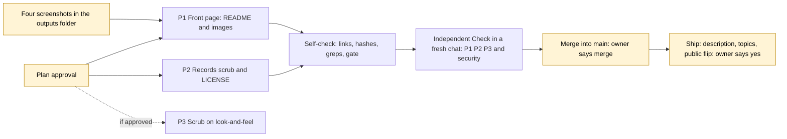

# Portfolio-ready plan

Status: built (P1 to P3, 2026-11-18). Approved 2026-11-18 by the owner's
"go" (P3 included; the open decisions at their defaults: screenshots as
given, tool names kept in the "How this was built" section, that section in
the first person). The independent Check was skipped on the owner's
instruction on 2026-11-18, and the owner authorized Ship the same day
(merge, description and topics, public, delete the merged remote branches).
Source of agreement: Clarify on
2026-11-18, where the owner answered four questions (showcase `main` as it
is and leave `look-and-feel` unmerged; plan for a public repository; MIT
license; README only, using the owner's four iPhone screenshots);
`README.md` on `main`; `docs/releases/0.1.0.md`; `docs/agents/checks.md`
(H1 and security rows at 4c8cdb0); `docs/DECISIONS.md` 014; `AGENTS.md` Git
rules (no force-push, no deleted work); the owner's standing rules on
attribution, names and the stop after each phase. Work happens on branch
`portfolio-ready` in the worktree `.claude/worktrees/portfolio-ready`, cut
from `main` at 4fef33f on 2026-11-18.

## Goal

Someone who opens `github.com/AymAbdalla/spend-app` from a CV or a LinkedIn
message understands in one screen what SPEND. is, sees it running on an
iPhone, learns how it was built and verified, and can build it themselves.
The app on `main` does not change: version 0.1.0 plus History, at 4fef33f.
The repository becomes public under the MIT license, with the owner's home
folder path removed from the documents a visitor reads. The `look-and-feel`
branch stays unmerged with its check results, apart from the same path scrub
if slice P3 is approved.

How it works, in plain terms: GitHub shows `README.md` as the repository's
front page, so the README is the portfolio. Images committed to the
repository render in the README through relative links. GitHub reads a
`LICENSE` file at the root and shows the license name on the page. Topics are
tags that make the repository findable. Visibility is one repository
setting, flipped with one command at the end.

## Agreed behavior

| Situation | Result |
| --- | --- |
| A visitor opens the repository page | The README shows, in this order: the name and tagline with one sentence saying what the app is; the four phone screenshots in a row; what the app does; why it exists; how it is built; how it was verified; status and known limits; how to run it; the documents map; the license. |
| A visitor clicks a screenshot | The full-size PNG opens from `docs/images/`. Pixels are the owner's originals; the file carries no metadata (no EXIF, no XMP). |
| A visitor reads `docs/agents/build.md` or `status.md` on `main` | No `/Users/<name>` path appears. Every row, fact and date is otherwise unchanged. |
| A visitor looks for the license | `LICENSE` holds the MIT text with `Copyright (c) 2026 Ayman Abdalla`, and GitHub shows "MIT license" on the repository page once it is on `main`. |
| A visitor searches GitHub topics | The repository is listed under `swift`, `swiftui`, `swiftdata`, `app-intents`, `ios` and `personal-finance`, and its description reads "SPEND. A privacy-first manual spending journal for iPhone that opens from the Action Button." (set at Ship). |
| Anyone on the internet | Can read, clone and fork after the flip; only the owner can push (GitHub default). |
| A visitor clones and builds | Unchanged from today: open `ios/SPEND.xcodeproj`, run on a simulator; 49 of 49 tests as checked at 4c8cdb0. No file under `ios/` changes in this round. |
| `CHANGELOG.md`, `MARKETING_VERSION`, tags, releases | Unchanged. No new version and no new release. |
| The `look-and-feel` branch | Unchanged, except one documentation commit that removes the home path if P3 is approved. Its `checks.md` rows stay as the checker wrote them. |
| Git history | Not rewritten. Older commits keep the home path; `AGENTS.md` forbids force-push and the records are honest history. |

### Scope

In scope: `README.md` rewritten; `docs/images/` with the four PNGs
(metadata stripped, pixels unchanged); `LICENSE`; the path scrub in
`docs/agents/build.md` and `docs/agents/status.md` on the branch; the
`status.md` line and the `build.md` rows for this round; the same scrub on
`look-and-feel` (P3, optional); pushing the branch; at Ship, the GitHub
description, the topics and the visibility flip, each with its own yes.

Out of scope: any change under `ios/`; merging or fixing `look-and-feel`
(LF1 and LF3 stay open); a version bump, a `CHANGELOG.md` entry or a GitHub
release; rewriting history; a portfolio case document; a website or App
Store assets; deleting branches unless the owner says so at Ship.

### Terms

- **Front page:** the README GitHub renders under the file list.
- **Relative link:** a path like `docs/images/dashboard.png` that GitHub
  resolves inside the repository, on any branch.
- **PNG chunks:** a PNG is a list of blocks. `IHDR`, `IDAT` and `IEND` hold
  the picture; `sRGB`, `iCCP`, `cICP` and `pHYs` describe color and
  resolution; `eXIf` and `iTXt` hold metadata (here: the capture time, the
  orientation flag and the word "Screenshot"). Dropping the last two leaves
  the picture byte-for-byte the same.
- **Merge gate:** `agents_gate.py check --base main` in the check-this
  skill. It reads the first table in `build.md`, so this round's rows go
  directly after the H1 row, not at the end of the file (the mistake the
  LF1 check found on `look-and-feel`).
- **Topics:** lowercase tags on the repository, set with `gh repo edit`.

### README outline

Build writes the words; the facts come from the sources named here, and the
Check compares each number with its source.

1. **Name, tagline, one sentence.** "SPEND." and "Feel every dollar." as
   today, then: a privacy-first manual spending journal for iPhone that
   opens straight into entry from the Action Button. No badges: there is no
   CI.
2. **Screenshots.** A table of four `` tags at about 200 pixels wide
   with alt text, in the order `dashboard.png`, `quick-entry.png`,
   `dashboard-breakdown.png`, `dashboard-recent-purchases.png`. GitHub
   honors `width` on `` inside Markdown. One line under the row says
   they were taken on the owner's iPhone on 2026-11-18 at version 0.1.0 plus
   History.
3. **What it does.** From `docs/releases/0.1.0.md` "What you can do" plus
   History and the detail (DECISIONS 014): the Action Button, Quick Entry,
   the Dashboard, History by day, the read-only detail, everything on the
   phone.
4. **Why.** From `docs/PRODUCT.md`: digital payments hide the feeling of
   spending; logging each purchase by hand is the feature, not a gap; the
   hypothesis still needs user validation.
5. **How it is built.** From `docs/ARCHITECTURE.md` and `CHANGELOG.md`:
   SwiftUI and SwiftData, local-first, no backend, analytics or third-party
   dependencies; the App Intent behind the shortcut; money as integer cents
   with no floating point; calendar-aware periods; complete file protection
   on the journal; XcodeGen project with the generated project checked in;
   iOS 17 target. Short paragraphs with a link to the document each comes
   from.
6. **How it was verified.** 49 automated tests (34 unit, 15 UI) on two
   simulators, from the H1 check row at 4c8cdb0; every slice checked in a
   fresh session and recorded in `docs/agents/checks.md`; a security pass
   per batch; phone steps named as owner-observed where that is what they
   were.
7. **How this was built.** Four to six sentences in the owner's first
   person: each feature starts as a spec and a plan in `docs/plans/`, is
   built in slices with records in `docs/agents/`, is checked by an
   independent fresh session before it merges, and ships only after that.
   Claude Code built and checked the slices, in separate chats, as the
   records say. This names the tools as part of the process, which the
   owner's rules allow; no line credits a tool as the author of the code or
   the document.
8. **Status and known limits.** 0.1.0 plus History on `main`; the
   `look-and-feel` branch (icon, accent, Dashboard cards, design system)
   built 2026-11-08, with LF2 and security passed and LF1 and LF3 open in
   its check log; the limits still true on `main` from
   `CHANGELOG.md`: no edit or delete, no CSV export, no reflection, no app
   icon, the recent-purchase overlap on the iPhone 18 Pro, USD only.
9. **Run it.** The current simulator, test, iPhone and regenerate sections,
   tightened, with the same commands.
10. **Documents.** One line per file in `docs/` and the two record folders.
11. **License.** MIT, with a link to `LICENSE`.

Proposed, not agreed (cheap to change): the "How this was built" section in
the owner's first person, the rest impersonal, like the documents. Say so to
make it all impersonal.

## Slices

| # | Slice | Surfaces | Change | Acceptance check | Blocked by |
| --- | --- | --- | --- | --- | --- |
| P1 | Front page | `README.md`; new `docs/images/dashboard.png`, `quick-entry.png`, `dashboard-breakdown.png`, `dashboard-recent-purchases.png`; `docs/agents/build.md` (P1 row after the H1 row); `docs/agents/status.md` | Rewrite the README to the outline above; copy the four screenshots from `~/aym/agents/outputs/spend/portfolio-ready/screenshots/` and strip their `eXIf` and `iTXt` chunks. | Every relative link and image path in `README.md` resolves to a tracked file (a script in the scratch folder lists each one with exists or missing: 0 missing). Each PNG's `IHDR` plus concatenated `IDAT` bytes hash the same as the owner's original, and its chunk list has no `eXIf` or `iTXt`. `git grep` on the branch finds no `/Users/`, no `DEVELOPMENT_TEAM = ` followed by a value, and no email in `README.md`. Every number in the README matches its named source row. After `git push -u origin portfolio-ready`, `https://github.com/AymAbdalla/spend-app/blob/portfolio-ready/README.md` shows the four images (owner-visible while private; the checker confirms with `gh api` that the four image paths exist on the branch). | nothing |
| P2 | Public-safe records and license | `LICENSE`; `docs/agents/build.md` prose (21 path mentions); `docs/agents/status.md` (1 mention, plus this round's line); `build.md` P2 row | Replace `/Users/<username>/` with `~/` wherever it appears in the two record files, so each path keeps its meaning without the username; add the MIT text with the owner's name and 2026. | `git grep -c '/Users/'` on the branch reports no tracked file. `git diff main -- docs/agents/build.md` changes only lines that contained the path, plus the new rows after the H1 row. `python3 <check-this>/scripts/agents_gate.py check --base main` lists exactly the slices this round added, refuses only for "no independent pass" and "no security pass" (expected before the Check), and reports no column, State or self-check problem. `LICENSE` equals the SPDX MIT text apart from the copyright line, which reads `Copyright (c) 2026 Ayman Abdalla`. | nothing |
| P3 | Scrub on `look-and-feel` (optional) | On branch `look-and-feel` in its worktree: `docs/agents/build.md` (21), `docs/agents/status.md` (1), `docs/plans/look-and-feel.md` (2); one documentation commit; push | The same substitution. `checks.md` untouched. | `git grep -c '/Users/'` on `look-and-feel` reports no tracked file; the commit's diff changes only lines that contained the path; `git ls-remote origin refs/heads/look-and-feel` equals the local head. | The owner's yes in the approval |

Ship, after the Check and each with its own authorization: merge
`portfolio-ready` into `main` with the gate passing (the owner says
"merge"); push `main`; `gh repo edit` with the description and the six
topics; `gh repo edit --visibility public
--accept-visibility-change-consequences` after the owner's yes; then verify
with `gh repo view --json visibility,licenseInfo,repositoryTopics` and an
unauthenticated fetch of the README.

Two slices because each ends in something different to observe: a front page
with pictures, and a repository whose records and license are safe to show.
P3 is separate because it touches a branch the owner chose to leave alone.

## Dependencies

| Dependency | Needed by | Exists now? | Provider | If missing |
| --- | --- | --- | --- | --- |
| `gh` 2.104.0 logged in as AymAbdalla | P1 push, Ship | Yes, checked 2026-11-18 | Installed | Stop and report; the owner runs the commands |
| The four screenshots with SHA-256 recorded (dashboard 1abb2ff1…, quick-entry 16124464…, dashboard-breakdown b12304b3…, dashboard-recent-purchases c8562eac…) | P1 | Yes, `~/aym/agents/outputs/spend/portfolio-ready/screenshots/` | Owner, copied 2026-11-18 | Ask the owner to re-share them |
| Python 3 for the PNG chunk strip and the gate | P1, P2 | Yes, used today | Installed | Strip with another tool and show the chunk list |
| Worktree `.claude/worktrees/portfolio-ready` on `portfolio-ready` at 4fef33f | All | Yes, created 2026-11-18, excluded in `.git/info/exclude` | Created in Plan | Recreate from `main` |
| MIT license text | P2 | Standard text, no download needed | SPDX | n/a |
| Xcode and simulators | None: no file under `ios/` changes | Yes | Installed | n/a; the Check confirms `git diff main --stat -- ios/` is empty instead of rebuilding |
| Owner's yes for merge, description and topics, the public flip, branch deletion | Ship | Not yet | Owner | Stop at the Ship card |

## Verification

| Requirement | Check | Runs now? |
| --- | --- | --- |
| README renders with the four images | Link and image resolution script (0 missing); the branch view on GitHub after the push | After P1 |
| Pixels unchanged, metadata gone | `IHDR` plus `IDAT` hash equal to the original; chunk list without `eXIf` or `iTXt` | After P1 |
| Every README number traces to a source | Checker reads each number beside its source row (checks.md H1, CHANGELOG, releases/0.1.0) | After P1 |
| No home path on the branch tip | `git grep -c '/Users/'` reports nothing | After P2 (and P3) |
| Records readable by the gate | `agents_gate.py check --base main`: this round's slices listed, no format problem | After P2 |
| No secret anywhere in history | Today's scan over `git log -p --all`: 0 private keys, tokens or team IDs; the one pattern hit is the documented fake `FAKETEAM01` in the AB2 record. Rerun before the flip | Now; again at Ship |
| No personal email in history | Today's scan: only the GitHub noreply address | Now; again at Ship |
| Code unchanged | `git diff main --stat -- ios/` empty | After each slice |
| No AI attribution | `git log main..HEAD --format=%B` has no Co-Authored-By, Generated or tool-as-author line; `README.md` and `LICENSE` credit no tool as author | After each slice |
| License detected | `gh repo view --json licenseInfo` shows MIT | After merge (Ship) |
| Public and readable | `gh repo view --json visibility` is PUBLIC; `curl` of the raw README without a token returns it | Ship |
| Independent Check | Fresh chat checks P1 and P2 (and P3) and security at the final commit, writes `checks.md` in a commit of its own | After Build |

## Security

- **Worth protecting:** the owner's real purchases and totals in the four
  screenshots (the owner chose to publish them on 2026-11-18, question 4 of
  Clarify); the Mac username inside paths (removed from the branch tips;
  older commits keep it because the project forbids rewriting history);
  the signing team ID (today's history scan: 0 real matches, 1 documented
  fake value; the local signing file is git-ignored and absent from every
  worktree); the screenshots' metadata (capture time, orientation,
  "Screenshot": stripped before commit).
- **Who can reach it, and how:** after the flip, anyone on the internet, for
  good: clones, forks and caches survive a later return to private.
- **What stops misuse:** the flip is the last step and needs the owner's
  yes; the Check's security pass reruns the history scan and the greps on
  the final commit before merge; GitHub lets only the owner push; no secret,
  package, network call or analytics exists in the repository (every
  security row since 2026-11-06). Nothing in this round adds code, a
  dependency or a build step.

## Risks, open decisions and fog

- Open decision: P3, the scrub on `look-and-feel` (needs the owner;
  recommended yes, same username exposure as `main`).
- Open decision: delete the merged remote branches `quick-entry-dashboard`
  and `action-button-shortcut` from GitHub at Ship, so visitors see `main`
  and `look-and-feel` only (needs the owner; recommended yes; their commits
  stay in `main`'s history). Not done unless the owner says so.
- Open decision: crop the status strip (clock, Dynamic Island, battery) off
  the top of the four screenshots (needs the owner; default: as given).
- Open decision: the "How this was built" section names Claude Code as the
  tool, inside a description of the process (needs the owner; default: keep;
  say "no tool names" to drop them).
- Risk: GitHub does not detect the license if the text deviates. -> Use the
  SPDX MIT text verbatim, and verify at Ship.
- Risk: this round's `build.md` rows land outside the first table and the
  gate ignores them. -> Rows go directly after the H1 row; P2's acceptance
  runs the gate and expects it to list them.
- Risk: the gate refuses the merge because the Check is missing or stale.
  -> Every file change is committed before the Check starts; the Check
  records P1, P2 (P3) and security at the final commit.
- Risk: README numbers drift from the records. -> Each number names its
  source; the Check compares them.
- Risk: the screenshots, at 1206 by 2622 pixels and about 2 MB together,
  slow the page a little. -> Accepted; they stay faithful originals, and
  `width` keeps the row compact.
- Risk: a later return to private cannot recall what was already cloned.
  -> Said plainly here and on the Ship card before the flip.
- Fog: how the image table reads on a phone browser; look at it on the
  owner's phone after the push and adjust the width if needed.
- Fog: the owner may want a portfolio case document later; separate request.

## Flow

## Approval

Approving this plan authorizes Build of P1 and P2 on `portfolio-ready` in
the worktree `.claude/worktrees/portfolio-ready`: the README rewrite, the
four PNGs with their metadata stripped, `LICENSE`, the path scrub in the two
record files, this plan's status line, the agent records, commits of each
finished slice and its records on that branch, and pushing that branch to
`origin` so the GitHub view check and a cloud Check can run. "go" also
approves P3: the same scrub as one documentation commit on `look-and-feel`,
pushed. Say "go without P3" to leave that branch untouched. Merging, the
repository description and topics, the public flip, deleting any branch, any
change under `ios/`, a version bump, a changelog entry and a release each
need their own authorization at Ship.
