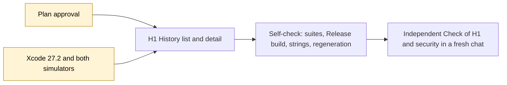

# Transaction history plan

Status: approved by the owner on 2026-11-07, who asked to build slice H1 with
this plan (that accepts the shared-row change in "Risks" and the stated
defaults). H1 built the same day; see `docs/agents/build.md`. Source of
agreement: Clarify on 2026-11-07 (the owner chose option 1, "list and detail
only", and accepted the stated defaults), `docs/ROADMAP.md` Phase 1 ("Transaction history" before
"Edit and delete"), `docs/UX.md` Transaction History (the chronological list;
edit, delete, category filtering and search stay later), `docs/PRODUCT.md`
MVP requirements, `docs/DECISIONS.md` 007 to 013 and `docs/ARCHITECTURE.md`.
Work happens on branch `transaction-history` in the worktree
`.claude/worktrees/transaction-history`, cut from `main` at e201eeb.

## Goal

The owner opens a History screen from the Dashboard and sees every saved
purchase, newest first, grouped by day with each day's total, then taps a
purchase to read every saved field. History is read-only in this slice:
nothing is edited, deleted, filtered or searched, and nothing new is saved
from it. The Dashboard keeps its five most recent purchases; History is where
"feel every dollar" becomes "see every dollar".

How it works, in plain terms: the app already keeps every purchase in its
local journal, and the Dashboard already asks the journal for them newest
first and shows five. History asks for the same list and shows all of it, cut
into one section per calendar day using the phone's calendar and time zone,
adding up each day's cents with the same overflow-checked arithmetic the
Dashboard totals use. Tapping a row pushes a detail screen that reads the same
stored record. No new storage, no copy of the data, no network.

## Agreed behavior

| Situation | Result |
| --- | --- |
| Dashboard | The "Recent purchases" header gains a "See all" link on its right. Tapping it pushes History onto the existing navigation stack. |
| Dashboard, tap a recent purchase | Pushes that purchase's detail screen. |
| History with purchases | An inset grouped list (the rounded-card list style iOS Settings uses), one section per calendar day, newest day first and newest purchase first within a day. Each section header shows the weekday and date on the left ("Thu, Nov 6, 2026") and that day's total on the right. Each row shows the merchant with the amount at the trailing edge, then category · type, then the time. |
| History with no purchases | An empty state: "No purchases yet." and "Purchases you save appear here, newest first." Back returns to the Dashboard. |
| Future-dated purchase | Appears in History under its own day. Dashboard totals still exclude it (unchanged). |
| Tap a History row | Pushes the detail: amount large, merchant, full date and time, then Category and Type, and a Notes section only when notes exist. Read-only: no Edit or Delete controls yet. |
| Back | Returns to the previous screen. Nothing is saved or changed by visiting History or a detail. |
| "Log a purchase" shortcut while History or a detail is showing | The app pops back to the Dashboard, then opens Quick Entry exactly as today, so "Purchase saved." lands on the Dashboard. If Quick Entry is already open, the draft is kept (unchanged). |
| Journal still opening, or failed to open | Unchanged: the loading or "Try again" screen shows first. History is reachable only once the Dashboard shows. |
| Relaunch | History shows the same purchases from the journal. There is no separate cache. |
| Accessibility text sizes | The row amount moves under the merchant, headers wrap, everything scrolls and stays reachable, as the Dashboard rows do today. |
| Dark mode | The same system grouped surfaces the Dashboard uses. |

Proposed defaults, cheap to change: screen title "History"; detail title
"Purchase"; header date as weekday, month, day and year; the Dashboard's
recent rows adopt the same shared row layout as History (amount at the
trailing edge) so both places look alike. Out of scope: category filter,
search, edit, delete, a tab bar, month summaries, charts, paging, CSV.

## UI pattern research (Mobbin)

Reviewed on 2026-11-07 through Mobbin. Patterns inform structure only; SPEND.
uses original copy and composition with system typography, neutral surfaces
and native controls, and copies no product's design or branding.

| Reference | Observed pattern | Use for SPEND. |
| --- | --- | --- |
| [YNAB transactions](https://mobbin.com/screens/f094bf8d-058e-44b8-8968-f5e68743f543) | Full-date section headers; each row shows the payee with its category beneath and the amount at the trailing edge; a memo sits in a muted band under the row. | Full-date headers; merchant with category · type beneath; amount trailing. Notes stay on the detail screen, not in the row. |
| [Up transaction list](https://mobbin.com/screens/ce919d50-33c1-4470-89ef-68eb34e0bc27) | Uppercase weekday-and-date headers; the time of day sits under the merchant inside each day; one month per screen title. | Time under the merchant within a day section. Month paging is not needed yet. |
| [Copilot transactions](https://mobbin.com/screens/39449ee8-750e-432e-b82f-251a0eb74bbe) | Compact weekday-and-date headers, dense rows with a category chip, a period summary card and search at the top. | Weekday in the header. Search and period summaries are deferred, per Clarify. |
| [Sweatcoin transactions history](https://mobbin.com/screens/ac3e408c-2e9f-44cc-844b-3fed52ea6d72) | Each day is a card with that day's total in its header and the day's items nested beneath; empty days are still listed. | A day total in every section header. Only days with purchases are listed. |
| [N26 transaction detail](https://mobbin.com/screens/3207d1d6-6ae0-4931-8073-df83a0194d8b) | Amount-first hero with the date and time beneath, a labelled Details list (category, account, type) and a separate Notes section. | Detail: large amount, merchant, full date and time, labelled rows, a Notes section only when there are notes. |

## Design

- **History screen.** Lives inside the Dashboard's existing `NavigationStack`.
  A `List` in `.insetGrouped` style with one `Section` per day. The header is
  a row with the date text, a spacer and the total in monospaced digits.
  Accessibility identifiers: `historyList`, `daySection.<yyyy-MM-dd>`,
  `dayTotal.<yyyy-MM-dd>` and `historyRow` for each row.
- **Shared row.** One `PurchaseRow` view used by the Dashboard and History:
  merchant (headline) with the amount trailing (semibold, monospaced digits);
  second line category · type (secondary); third line the time in History or
  the date and time on the Dashboard. At accessibility text sizes it stacks
  vertically, as the Dashboard's total rows already do. It is one combined
  accessibility element; the Dashboard keeps the identifier `purchaseRow`.
- **Detail screen.** `PurchaseDetailView(purchase:)`: a grouped list whose top
  card shows the amount in the Dashboard's large rounded style, the merchant,
  and the full date and time; a Details section with Category and Type; a
  Notes section only when notes exist. Identifiers: `detailAmount`,
  `detailMerchant`, `detailDate`, `detailCategory`, `detailType`,
  `detailNotes`.
- **Navigation.** The Dashboard's stack becomes `NavigationStack(path:)`
  with value-based links: a small `HistoryDestination` marker for the History
  screen and the `Purchase` record for a detail. Value-based means each push
  is an entry in a list the app owns, so the shortcut handler can clear that
  list ("pop to root") before opening Quick Entry. Plain destination links
  would not pop.
- **Day grouping.** `DaySections` in `ios/SPEND/Services/`: a pure function
  that takes anything with a date and an amount in cents (a tiny protocol that
  `Purchase` and `SpendingRecord` already satisfy) plus a `Calendar`, and
  returns `[DaySection]` (day start, total, items) newest first. It throws
  `totalTooLarge` on overflow and `invalidRecord` for a non-positive amount,
  the same errors `SpendingSummary` uses, and the screen shows that message
  instead of a partial list.
- **Test seed.** A DEBUG-only launch argument `-seed-history-fixture`, valid
  only with the existing `-journal-test-store` UUID, saves four synthetic
  purchases through `PurchaseWriter` when the test store is empty. Dates are
  built from the device calendar so headers are deterministic in any time
  zone: Jan 15, 2026 09:05 "Corner bakery" 4.50 Food & drink Impulse; Jan 15,
  2026 18:40 "Weekly grocer" 32.10 Groceries Planned with notes "Weekly shop";
  Jan 14, 2026 12:00 "Bus fare" 2.75 Transport Planned; Jun 1, 2030 10:00
  "Festival ticket" 60.00 Entertainment Planned. Day totals: $36.60, $2.75,
  $60.00. The Release binary must not contain the argument; its name is longer
  than 15 bytes so the strings check can find it (lesson from AB1's check).

## Slices

Slice id `H1` in `docs/agents/build.md` and `checks.md`.

| # | Slice | Surfaces | Change | Acceptance check | Blocked by |
| --- | --- | --- | --- | --- | --- |
| H1 | History list and purchase detail | New `ios/SPEND/Features/History/` (`HistoryView`, `PurchaseDetailView`, `PurchaseRow`), new `ios/SPEND/Services/DaySections.swift`, `DashboardView.swift` (See all, tappable rows, path, pop to root), `AppConfiguration.swift` (DEBUG seed hook), new `ios/SPENDTests/DaySectionsTests.swift`, new `ios/SPENDUITests/HistoryUITests.swift`, existing UI tests touched only where an identifier or element type changes, regenerated `SPEND.xcodeproj`, `docs/ARCHITECTURE.md`, `docs/DECISIONS.md` (014), `docs/ROADMAP.md` (tick "Transaction history"; add an unchecked "History category filter and search"), `README.md` status, this plan's status line, `docs/agents/build.md` and `status.md` | Add the History screen, the shared row, the read-only detail, day grouping with totals, See all and row navigation, pop to root for the shortcut, the DEBUG seed hook, tests and documentation. | On a seeded test store: Dashboard → See all shows History with three day sections in the order Jun 1, 2030; Jan 15, 2026; Jan 14, 2026, totals $60.00, $36.60 and $2.75, and four rows; tapping Weekly grocer shows $32.10, Weekly grocer, Groceries, Planned, Jan 15, 2026 at 6:40 PM and "Weekly shop"; Back returns to History; the Dashboard's today total stays $0.00. A relaunch without the seed argument shows the same sections. A fresh store shows the empty state. All 37 existing tests still pass on iPhone 17 Pro and SPEND Small Phone (iOS 26.5); the Release simulator build passes; the seed argument is absent from the Release binary. | Plan approval; installed Xcode and simulators. |

One slice: a list without the detail, or grouping with no screen, would be a
layer rather than a slice, and the detail is small. Build order inside the
slice: `DaySections` tests red, then green; History with See all (UI test red,
then green); detail and tappable Dashboard rows; the pop-to-root test; the
shared row on the Dashboard; documentation; self-check; records.

**Order of work and checks.** Every documentation change (README, ROADMAP,
DECISIONS, ARCHITECTURE and this plan's status line) is committed before the
independent Check starts, because the merge gate treats any commit outside
`docs/agents/` as new code. One fresh chat then checks H1 and security at the
final commit. No throwaway spikes are planned: value-based navigation,
sectioned lists and `@Query` are standard iOS 17 SwiftUI and SwiftData.

## Dependencies

| Dependency | Needed by | Exists now? | Provider | If missing |
| --- | --- | --- | --- | --- |
| Xcode 27.2 (27B52) with the iOS 26.5 runtime (23F77) | Build and tests | Yes | Installed | Stop and report the tool error |
| iPhone 17 Pro `6392B603-3453-49E8-9124-17FBBAC89C3D` and SPEND Small Phone `45D6AC76-2BBA-490E-9A09-E35E2419A1F2`, both iOS 26.5 | Test runs | Yes, both listed and booted on 2026-11-07 | Installed | Recreate SPEND Small Phone as an iPhone SE 3rd generation with `simctl`, with the owner's yes |
| XcodeGen 2.46.0 | Project regeneration after adding files | Yes, `/opt/homebrew/bin/xcodegen` | Installed | Stop; the project is never hand-edited |
| Mobbin pattern search | This plan | Done above | Mobbin MCP | n/a |
| Signing file `ios/Config/Signing.local.xcconfig` | Not needed: simulator only | Absent from the worktree (git-ignored) | Owner | Copy it from the main folder only if a phone install is wanted later |
| iOS 17 to 25 runtime | Older-iOS behavior | No (26.5 and 27.0 only) | Apple download, owner's yes | Marked unavailable, as before |
| Legacy-journal cleanup | Not needed: H1 writes nothing to the journal | n/a | Edit and delete slice | n/a |

## Verification

| Requirement | Check | Runs now? |
| --- | --- | --- |
| Day grouping and totals are exact | Unit tests with fixed calendars and time zones (UTC, America/New_York on a daylight-saving day, a year boundary): sections newest first, purchases newest first within a day, 10 + 20 = 30 cents, a future date included, empty input gives no sections, overflow and non-positive amounts throw. | After H1 code exists |
| History shows every purchase grouped by day | UI test on the seeded store: three headers in the stated order with their totals, four rows. | After H1 |
| See all and Back | UI test: the link exists on the Dashboard; History shows; Back returns to the Dashboard. | After H1 |
| Detail shows every field | UI test: tap the seeded row with notes; assert each detail identifier's text. | After H1 |
| Dashboard row opens the detail | UI test: save 12.34 Test cafe, tap the row, the detail shows $12.34 and Test cafe, Back. | After H1 |
| Empty state | UI test on a fresh store: See all shows the empty text and zero rows. | After H1 |
| Relaunch | UI test: relaunch without the seed argument; the same sections show. | After H1 |
| Future-dated purchase shown, totals unchanged | UI test: the Jun 1, 2030 section exists; the Dashboard's today total is $0.00. | After H1 |
| Shortcut from History pops to the Dashboard | UI test with `-run-log-purchase-on-activate`: open History, leave and return, Quick Entry appears; Cancel; the Dashboard's Add purchase is hittable and the History title is gone. | After H1 |
| Accessibility sizes and dark mode | UI test at the largest accessibility size in dark mode: headers and rows exist, a row is hittable after scrolling; screenshots attached. | After H1 |
| Existing behavior unchanged | Full suites on both simulators: the 37 existing tests plus the new ones pass, 0 skipped; Release simulator build passes. | After H1 |
| Seed hook absent from Release | `strings` on the Release binary: 0 matches for the seed argument; the Debug library has 1, so the search can find it. | After H1 |
| Project regeneration byte-stable | XcodeGen run twice: identical project and scheme hashes; the diff only adds the new files. | After H1 |
| Normal journals untouched | SHA-256 of both simulators' normal journal, WAL and SHM files equal before and after the runs. | After H1 |
| Calm, readable screens | Visual self-review of light and dark screenshots on both simulators at default and accessibility sizes. | After H1 |
| Privacy | Security self-review below. | After H1 |
| Independent Check | Fresh chat checks H1 and security at the final commit. | After Build |

## Security

- **Worth protecting:** the journal (amounts, merchants, dates, notes).
  History and the detail show all of it on screen; the Dashboard already shows
  the latest five. Nothing leaves the device: no new storage, network,
  logging, analytics, packages or entitlements.
- **Who can reach it:** whoever holds the unlocked phone, as today. The
  complete file protection from DECISIONS 011 is unchanged; History reads
  through the same container and context.
- **What stops misuse:** the only new write path is the DEBUG seed hook,
  gated by `#if DEBUG`, a valid test-store UUID and the new argument, writing
  only into that test store through `PurchaseWriter`'s validation. Release
  must not contain it, and the strings check proves it. Test screenshots hold
  only synthetic data and live outside the repository. The screens render
  stored values as plain text and parse no new input.

## Risks, open decisions and fog

- Open decision: the Dashboard's recent rows adopt the shared row layout
  (amount at the trailing edge). Approving this plan accepts that visible
  change; say so to keep today's stacked card instead. (owner)
- Risk: existing UI tests find `purchaseRow` by identifier and read its label;
  wrapping rows in navigation links changes the element type. → Keep the
  identifier on the link and the combined label; rerun the full suites.
- Risk: pop to root needs value-based navigation; destination-closure links
  would not pop. → Every push uses `NavigationLink(value:)` with a matching
  `navigationDestination`; a UI test covers the shortcut from History.
- Risk: navigating with the `Purchase` record as the value is safe while
  nothing deletes; a deleted purchase on an open detail screen is the edit
  and delete slice's problem. → Recorded here for that slice.
- Risk: grouping runs in the view body on every change. Fine for hundreds of
  rows. → Fog: thousands of purchases would need a sectioned fetch; revisit if
  scrolling stutters.
- Risk: the seed must not depend on the run date. → Fixed calendar dates in
  the device time zone; the Dashboard's today total stays $0.00 until 2030.
- Risk: `ContentUnavailableView` and value-based navigation need iOS 17. →
  The deployment target is iOS 17.
- Fog: relative headers ("Today", "Yesterday") might read better than full
  dates; revisit after the owner has used History for a week.
- Fog: iOS 17 to 25 and spoken VoiceOver remain unchecked, as before.
- Not included: the Dashboard overlap at default text size and the app icon
  (release-note follow-ups) stay separate.

## Flow

## Approval

Approving this plan authorizes Build of H1 on `transaction-history` in the
worktree: the new Swift files, the Dashboard and AppConfiguration changes,
XcodeGen regeneration, simulator builds and tests, the documentation updates
listed in the slice table, and commits of the finished slice and its agent
records on that branch. Merging, pushing, the version bump and CHANGELOG entry
(ship), installing on the iPhone, and category filter, search, edit, delete,
CSV export or any other roadmap item need their own authorization.
